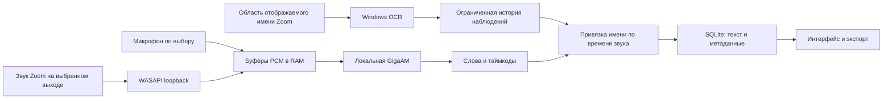

# Архитектура desktop-приложения

Приложение запускается системным Python 3.13 x64 на Windows 11. Zoom работает
обычным desktop-клиентом; приложение не подключает бота и не использует API
встреч. Для распознавания речи нужен локальный GigaAM Multilingual CTC.

Источник аудио и наблюдатель используют монотонные часы. Слова GigaAM имеют
относительные временные метки; начало сеанса переводит их в общую шкалу.
Имя относится к времени кадра Zoom. Для каждого слова оцениваются
подтверждённые интервалы OCR в окне
500 мс до начала / 1500 мс после окончания, ограниченном речевыми границами.
Это учитывает задержку отображения имени. Требуются достаточная взвешенная
поддержка и отсутствие позднего противоречия; тишина и известные наложения
остаются неизвестными. Последние 60 секунд истории и отдельно интервалы
принятых аудиобуферов сохраняются до обработки, чтобы медленная ASR не
переприсваивала старую речь текущему имени.

Хранилище может восстановить короткую неизвестную реплику между двумя
совпадающими прямыми OCR-подписями, отдельно отмечая `inferred_gap_fill`.
Прямая подпись, вывод по соседям и ручное исправление различаются в
метаданных и экспорте. Порог активности не разделяет голоса; два удалённых
голоса при неизменной строке Zoom этим способом не различаются.

OCR — локальный Windows.Media.Ocr, без скачивания модели во время сеанса.
Область выделяет пользователь в основном Speaker View. Повторное чтение
подтверждает строку; локальный ID строится в пределах сеанса, а не является
Zoom participant ID. Имя не устанавливается по аудио. Одинаковые подписи и
задержка переключения видео ограничивают точность связи даже при верном OCR.

Длительные нативные вызовы захвата и OCR изолированы от GUI и аудиозахвата. Остановка и
таймауты сбрасывают имя. Изображение остаётся в памяти. Логи диагностики нужны
для кодов отказов, а не для записи кадров или аудио.

| Область кода | Назначение |
|---|---|
| `app.py`, `Start_GigaAM.cmd` | Прямой запуск установленным Python. |
| `desktop_gui.py`, `zoom_calibration.py` | Настройки, калибровка, первый запуск, таблица текста. |
| `desktop.py` | Загрузка модели, lifecycle захвата/наблюдателя, остановка. |
| `desktop_audio.py` | WASAPI, монотонные таймкоды, resampling, ограниченная очередь. |
| `zoom_visual.py` | Чтение выбранной строки имени через Windows OCR. |
| `zoom_capture.py`, `zoom_wgc.py`, `zoom_window.py` | Выбор окна, WGC → PrintWindow → безопасный screen DC, геометрия и ограничение нативных вызовов. |
| `desktop_attribution.py` | История имён и привязка к словам аудио. |
| `engine.py`, `pipeline.py` | GigaAM CPU, окна аудио, публикация финальных слов. |
| `store.py`, `exports.py` | SQLite, исправление конкретной подписи, экспорт DOCX, PDF и TXT в интерфейсе. |
| `model_assets.py`, `scripts/acquire_model.py` | Проверенная установка GigaAM из GitHub Release. |

PCM не записывается. Очереди ограничены, пропуски отмечаются; окончание
программы завершает принятую обработку, но не восстанавливает утраченный звук.
SQLite хранит текст и происхождение подписи. `final` означает завершение
текстового результата, а не подтверждённую личность или безошибочность текста.
