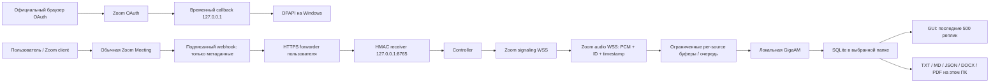

# Архитектура и карта потоков данных

## Компоненты

`gui.py` — Tk, русские состояния, выбранная папка, bounded queue 256 событий и
последние 500 реплик. `controller.py` — отдельный поток/asyncio loop жизненного
цикла. `auth.py` — PKCE S256 + state, временный loopback callback, ротация refresh
tokens. `config.py` — публичные настройки отдельно от user-bound Windows DPAPI.
`events.py` — проверяемый HMAC webhook и ограниченный dedup. `rtms.py` — официальные
signaling/media WebSocket сообщения. `pipeline.py` — один inference worker,
per-source окна и глобальный бюджет 48 секунд аудио. `engine.py` — закреплённая
GigaAM CPU float32. `store.py` — SQLite WAL. `exports.py` — локальные документы.

## Локальность

Аудио проходит обычную инфраструктуру Zoom и приходит напрямую локальному
приложению. Туннель webhook видит служебные идентификаторы и адреса RTMS, не PCM
и не транскрипт. Модель, inference, SQLite и экспорт на ПК. Модуль модели загружает
файлы с диска, проверяет SHA256 и `weights_only=True`, не вызывает model-hub loader.
Нет OpenAI/Whisper/внешнего STT/LLM клиента. Скрипт acquisition выполняется отдельно.

## Источник и часы

Ключ источника — `(rtms_stream_id:transport_epoch:rejoin_epoch, Zoom user_id)`.
Отображаемое имя — снимок метаданных во время реплики. Изменение имени завершает
окно, не изменяет уже сохранённый текст. После выхода окно завершается; новый
вход не объединяется по имени. Новый transport generation также сохраняется
отдельно. Это консервативно: одно лицо может иметь несколько source epochs.
Zoom user_id — ID источника встречи, не обещание постоянного account ID человека.

RTMS first timestamp и audio timestamps — epoch milliseconds. Начало хранится
один раз и не сбрасывается reconnect. `time_basis=rtms_session` явно означает
отсчёт RTMS, `first_audio` — fallback без официального origin. Это не точное
начало встречи при позднем подключении. Word timestamps добавляются к timestamp
начала PCM окна; окончания ограничены реальной длительностью звука.

## Длинные встречи

Per-source окно до 8 секунд, 2 секунды перекрытия. Половины перекрытия имеют
раздельное владение таймкодами; сравнение слов учитывает только пересечение PCM,
порядок и времена. Реальные повторения не удаляются по одному совпадению текста.
Завершение короткой фразы — примерно 1.2 секунды тишины/idle. Это оконное CTC,
не пословный streaming decoder; опубликованные реплики финальные.

Удержание двух секунд выбрано по фактической проверке казахского шва:
одна секунда приводила к дрейфу метки слова и повтору. Контекст не увеличивает
глобальный бюджет 48 секунд, но шаг окна 6 секунд добавляет CPU-работу.

Глобальный бюджет 48 секунд включает активную inference, окна в очереди и буферы.
При перегрузке новые блоки пропускаются с журналом gap и видимым сообщением.
Число активных source states ограничено 128; история живёт на диске. RTMS и UI
очереди также ограничены. SQLite cache 2 MiB и чтение batches по 256 строк;
данные текста на диске растут с встречей, RAM не хранит полный транскрипт.
TXT/MD/JSON потоковые; DOCX и PDF могут использовать дополнительную память
библиотек, поэтому для очень длинных встреч предпочтительны TXT/JSON.

## Завершение и ошибки

Start требует непостоянных галочек consent и billing. Сначала загружается модель,
потом явный REST Start и ожидание подписанного события. По ошибке/Stop отправляются
STREAM_CLOSE и REST Stop. Если ответ потерян, UI требует проверить Active Apps;
нет обещания, что обрыв сети прекратил списания. После остановки аудиоприёма worker
дорабатывает принятую очередь. Закрытие окна ждёт фоновые потоки. SQLite остаётся
доступным для восстановления и экспорта после перезапуска.

При потере consent приложение останавливает обработку; требования Zoom к
удалению данных отдельно указаны в PRIVACY.md и отчёте ограничений. TLS, hostname
verification и защиту Windows проект не отключает.
