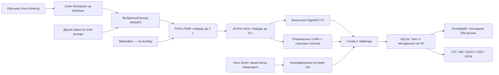

# Живой локальный транскрибатор: подробная инструкция и архитектура

Дата: 4 ноября 2026. Этот документ описывает новый основной `app.py`.
Предыдущие RTMS и импорт записей — отдельные дополнительные инструменты.

## 1. Что запускается и где

Всё приложение запускается на Windows-компьютере владельца. Обычный Zoom
передаёт встречу своим обычным способом. Наш код читает копию звука выбранного
выходного устройства через Windows WASAPI. Если включён микрофон, читает его
отдельно. Обработка — локально; приложение не подключает бота и не вызывает
Zoom API. Оно не является новым сервером или опубликованным Zoom App.

Запись встречи, облачная запись, Zoom captions и AI Companion не используются.
Технические слова capture/loopback означают получение текущих PCM-буферов,
а не создание аудиозаписи. Буферы нужны любой модели распознавания и освобождаются.
Приложение не создаёт аудио/видеофайл. Работа Windows paging/crash dumps вне
контроля приложения; это не обещание forensic-erasure всей оперативной памяти.



## 2. Почему этот путь выбран

SHAI/shainote — коммерческий сервис, который описывает бота и запись, а не
открытую локальную модель. Granola документирует захват системного звука/
микрофона и подсказки имён через Accessibility. Наш код реализован самостоятельно,
облачный STT этих сервисов не используется. [Подробное исследование](RESEARCH_ZERO_COST_LIVE.md).

Meeting SDK имеет технические raw-audio API, но актуальная главная страница
SDK запрещает bots/AI notetakers и направляет их к RTMS. Поэтому наличие
старого C++ примера не принято за разрешение нового бота. RTMS не выбран,
поскольку требуется гарантия отсутствия дополнительных списаний. Video SDK
создаёт другие сессии и не решает подключение к обычным Meetings.
[Проверка официальных источников](RESEARCH_ZOOM_CAPTURE.md).

## 3. Установка один раз

1. Установить Python 3.12 x64 с Tcl/Tk и Git, открыть папку этого репозитория.
2. Выполнить `setup.ps1`. Устанавливаются CPU Torch, GigaAM и desktop-зависимости.
3. Выполнить `python scripts/acquire_model.py` из `.venv`, либо выбрать уже
   существующую папку проверенной GigaAM. Исходный проект читается без изменений.
4. Для необязательного различения голосов выполнить:

```powershell
./.venv/Scripts/python.exe scripts/download_diarization.py
```

Команда явно скачивает 28 281 164 байта ONNX-модели CAM++, проверяет SHA256,
сохраняет provenance и сведения о лицензии рядом. Модель Apache-2.0; атрибуция в NOTICE.
В настройках выбрать `models/diarization/campplus.onnx`; на вкладке встречи
включить различение голосов. Если модель не нужна — оставить опцию выключенной.

5. Выбрать локальную папку результатов. Укажите существующую папку, не UNC
   и не сетевой диск. Для приватных встреч разумно выбрать папку вне синхронизации.
6. При необходимости выбрать микрофон и собственное отображаемое имя.

Ничего устанавливать в Marketplace не требуется. Существующий личный General
App можно оставить как есть: этот режим его не использует и не расширяет scopes.

## 4. Ежедневный запуск

Войти в обычный Zoom Workplace. В Zoom выбрать наушники и подключить звук
компьютера. Наше приложение → тот же выход в списке «Звук Zoom». Важно именно
совпадение устройства: другой выход может давать тишину, даже когда звонок слышен.

Выбрать папку, уведомить участников, нажать «Начать». Загрузка модели происходит
до открытия захвата: статус «Загрузка…» ещё не означает, что речь принимается.
После статуса работающего захвата фразы появляются окнами, а не мгновенно по
одному слову. Окончить кнопкой «Стоп и завершить текст», дождаться обработки
очереди, выполнить экспорт. Закрытие окна во время сеанса запускает такую же
остановку и ждёт фоновые операции.

Можно не читать текст в процессе и забрать документ в конце. Но приложение
всё равно должно работать во время всей нужной части разговора. Речь до старта,
при выключенном ПК, при неправильном выходе и во время пропуска недоступна.

## 5. Что захватывается

WASAPI endpoint loopback — общий звук выбранного выхода. Это не изоляция
процесса Zoom: музыка, уведомления и другое видео с этого выхода тоже поступят
в модель. Перед встречей остановите другие воспроизводящие приложения.
Процессный loopback исследован, но не реализован в этой версии.

Микрофон отключён по умолчанию. Если его включить, он получает ваш локальный
звук независимо от mute в Zoom. Ваше «сказано вне эфира» тоже может попасть
в локальный текст. Для остановки обработки нажмите Stop в нашем приложении.
Переключение микрофона применяется при следующем Start, не посреди захвата.
Наушники предотвращают акустическое повторение собеседников в микрофоне;
собственный echo-canceller не реализован. Общий микрофон с несколькими людьми
не является доказанно одним человеком.

Смена USB/Bluetooth-устройства требует Stop → обновить список → выбрать
устройство → новый Start. Тихий shared-mode renderer выдаёт цифровые нули
в выбранный выход, чтобы WASAPI сохранял непрерывную шкалу во время тишины.
Он не передаётся в Zoom как дополнительный участник/микрофон.

## 6. Кто говорит и насколько этому можно доверять

Текст и личность — разные результаты. GigaAM выдаёт слова и приблизительные
метки слов. CTC в этой реализации публикует финальные окна; `preliminary` не
симулируется. `final` не означает безошибочное распознавание или подтверждённое имя.

Порядок подписи удалённой речи:

1. Свежая, однозначная явная UIA-метка активного говорящего → `zoom_ui_hint`.
2. Если такой метки нет и включена голосовая модель, однозначный кластер → `voice_cluster`.
3. Иначе `unattributed_mix`, «Удалённый участник (не определён)».

Собственный микрофон — `local_microphone`, имя введено пользователем.
Исправления после звонка — `manual`. В интерфейсе выбранную реплику можно
подписать отдельно. Для голосового кластера есть «Подписать этот голос»:
переименуются только реплики того же локального voice ID и той же сессии.
Это ручное решение пользователя, не автоматическое установление личности.
Неизвестный смешанный источник целиком переименовать нельзя: там разные люди.

### UIA

Сканируются только видимые окна процесса Zoom.exe, без кликов/изменения Zoom.
Обычная карточка участника, крупный видео-тайл, pin/spotlight и список имён
не считаются признаком говорящего. Нужна явная доступная метка, соответствующая
поддержанному формату. Эти форматы пока контракт адаптера, а не доказательство,
что установленный Zoom выдаёт их во время встречи. Совместимость реального
клиента должна быть проверена отдельно. Подсказка маркируется «по окну Zoom».

Наблюдения не старше 2 с; слово с переходом источника/имени в защитном интервале
±300 мс остаётся без UI-подписи. История ≤120 с/512 наблюдений. Если окно зависло,
скрыто, структура изменилась, скан неполон или метки неоднозначны — unknown.
COM выполняется в отдельном процессе с таймаутом; UI и аудио от него не ждут.

UIA runtime identity не Zoom participant ID. Она может измениться после
перестройки окна и повторного входа. Одинаковые имена не объединяются по строке.
Снимок имени принадлежит времени фразы, позднее переименование не переписывает
историю автоматически. Человека за одним устройством идентифицировать невозможно.

### Голоса

CAM++ сравнивает локальные embeddings. Это приблизительная онлайн-
кластеризация, не идентификация по реестру людей. Нет базы известных голосов,
нет вывода имени по тембру. Центроиды живут только в RAM текущего сеанса,
не публикуются и не сохраняются для биометрического поиска.

Короткая реплика, шёпот, музыка, новый микрофон, смена языка, похожие голоса
и речь одновременно могут вызвать unknown, неверное объединение или
разделение одного человека на несколько номеров. Полноценного overlap-detector
и разделения наложенных голосов нет. Число кластеров ограничено 16; сверх
лимита неоднозначные новые голоса остаются неизвестными. Сходство cosine —
не статистически откалиброванная вероятность правильности.

## 7. Время, данные и восстановление

Начало шкалы — монотонное время локального старта захвата, не плановое время
встречи и не server timestamp Zoom. UTC старта сохраняется отдельно для
ориентира. Пакеты микрофона/выхода используют общий clock; после пропуска
время не сжимается. Цифры в миллисекундах не означают точность до миллисекунды.

Каждая реплика хранит `id`, `speaker_id`, `display_name`, `source_epoch`,
`start`, `end`, `text`, `status`, `attribution`. `speaker_id` начинается с
`local:`; номер голоса действителен только в своём `source_epoch`.
В JSON есть схема 2 и `timing=local_capture_seconds`, метаданные, реплики,
наблюдавшиеся источники и события/пропуски. Старые SQLite схемы 1 открываются
с добавлением поля `attribution=zoom_source_id` для прежних RTMS-реплик.

SQLite нужен для постепенного сохранения текста, больших встреч, восстановления
после перезапуска и потокового экспорта. Сервер базы не нужен. При аварии
сохранятся уже зафиксированные реплики; буферы ещё не распознанного звука
потеряются. Нельзя восстановить их из SQLite, потому что аудио там нет.

## 8. Память, CPU и задержка

Захват ограничен 2 секундами, Pipeline основного режима — 24 секундами
принятого звука, включая работу/очередь/буферы. Окно ASR 8 с с перекрытием 2 с;
пауза около 1,2 с завершает короткую фразу. GigaAM использует до 4 потоков CPU,
CAM++ — один. GPU не обязателен и в этих измерениях не применялся.

Если модель не успевает, новые блоки отбрасываются с отметкой, не складываются
бесконечно. Частичный результат не называется полным. Журнал растёт на диске
с длиной текста; RAM не держит весь разговор. GUI показывает 500 последних
реплик; снимки SQLite, модель, экспорт и UIA работают вне Tk-потока.

TXT/MD/JSON пишутся последовательно. DOCX/PDF используют память библиотек:
DOCX ограничен 2 млн символов, PDF 1000 страницами. Для очень длинных встреч
используйте TXT/JSON. Точный аппаратный отчёт — [DESKTOP_TESTING](DESKTOP_TESTING.md).

## 9. Что если

| Ситуация | Поведение / действие |
|---|---|
| Открыл приложение после половины звонка | Будет только звук после старта. |
| Выход выбран неправильно | Шкала звука молчит/слышны другие приложения; Stop, исправить устройство. |
| Выключил звук Zoom | Удалённая речь может перестать поступать; приложение не восстанавливает скрытый поток. |
| Zoom muted мой микрофон | Локальный микрофон всё ещё обрабатывается, если включён у нас. |
| Два человека говорят одновременно | Смешанная речь, возможны ошибки слов и источника; не гарантируется разделение. |
| У всех одно имя | UI identity различается где доступна; имя не ключ. Voice ID не доказывает личность. |
| Переименовался / вышел / вернулся | Не гарантируется постоянный Zoom ID; история не объединяется автоматически по имени. |
| Окно Zoom скрыто / UI поменялся | UI-подпись неизвестна; текст продолжает работать. |
| Нет модели голосов | Отключить опцию или явно скачать проверенную модель. |
| Модель голосов ошиблась в процессе | Сообщение, текст продолжает распознаваться без новых голосовых подписей. |
| Нет GigaAM / SHA не совпал | Start завершается ошибкой до захвата, без автозагрузки. |
| Не хватает CPU | Видны пропуски/очередь; уменьшить другую нагрузку или отключить голосовую модель. |
| Устройство отключилось | Захват завершается с ошибкой; уже принятый текст дорабатывается, затем новый сеанс. |
| Нет места/прав на диск | Ошибка записи, приём прекращается; нельзя обещать сохранность последних буферов. |
| Закрыл окно | Остановка устройств и завершение очереди; окно закрывается после фоновой работы. |
| Упал процесс/компьютер | Открыть SQLite; принятые, но не распознанные буферы утрачены. |
| Нужно лишь получить текст в конце | Запустить обработку до начала разговора, экспортировать после Stop. |
| Нужно без наушников | Возможны акустические повторы; приложение не имеет AEC. |
| Конфиденциальная встреча | Согласие участников/организационные правила сохраняются; папка локальная, без аудио. |

## 10. Карта нового кода

| Файл | Ответственность |
|---|---|
| `app.py`, `start.ps1`, `setup.ps1` | Основной бесплатный запуск/установка. |
| `desktop_gui.py` | Русский UI, устройства, папки, текст, исправления, экспорт. |
| `desktop.py` | Фоновый lifecycle, настройки без секретов, загрузка/остановка, метаданные. |
| `desktop_audio.py` | WASAPI, shared silence, sample clocks, resampling, очередь, ошибки устройств. |
| `zoom_accessibility.py` | Экспериментальные явные UI-подсказки Zoom, отдельный процесс. |
| `diarization.py` | Проверка ONNX, embeddings, ограниченная кластеризация и история. |
| `desktop_attribution.py` | Привязка отдельных слов к UI hint/голосовому кластеру/unknown. |
| `pipeline.py`, `engine.py` | Ограниченные окна, overlap ownership, настоящий GigaAM CPU. |
| `models.py`, `store.py`, `exports.py` | Контракты, SQLite, ручные подписи, пять форматов. |
| `scripts/evaluate_desktop.py` | Реальный WASAPI+ASR прогон публичных примеров, метрики/экспорты. |
| `scripts/probe_desktop_audio.py` | Аппаратная проверка loopback без модели. |
| `app_rtms.py`, `gui.py`, `controller.py`, `rtms.py`, `auth.py`, `events.py` | Предыдущий отдельный RTMS путь; не вызывается бесплатным стартом. |

## 11. Распространение в компании

Публичный GitHub содержит код, документацию, тесты и обезличенные отчёты.
Модели, личные настройки, токены, транскрипты и аудио не входят в Git.
Каждый сотрудник может установить локальную копию с одобрения организации.
Расход CPU/RAM и документы остаются на его компьютере.

Включение в внутренний каталог Zoom само по себе не превращает локальный
движок в облачный. Но этот desktop-режим не нуждается в каталоге Zoom и его
доступ не регулируется Zoom OAuth. Если нужно назначение доступа сотрудникам,
корпоративная установка/управление приложением — отдельная будущая функция;
не следует выдавать текущую программу за систему управления доступом.
Текущая работа не включала Enterprise rollout, публикацию Marketplace, изменение
security settings, покупки или организационный auto-start.

## 12. Приёмка настоящей встречи

Нужны два-три согласованных участника с разными устройствами/наушниками,
KK/RU/EN реплики с известным эталоном, паузы, смена говорящего, одинаковые имена,
rename/rejoin, mute/unmute, overlapping speech и стоп. Не включать Zoom Record.
Зафиксировать только агрегированные метрики и ошибки; личный текст/аудио не
публиковать. Проверить все экспорты, поздний старт, отсутствие новых соединений
STT и отсутствие аудио/видеофайлов в папке результатов. Сравнить имена вручную.

До такого прогона можно утверждать аппаратную проверку WASAPI+модели, но не
«полностью проверенный Zoom-сервис». Точная открытая граница остаётся в отчёте.
