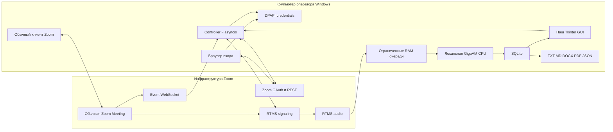
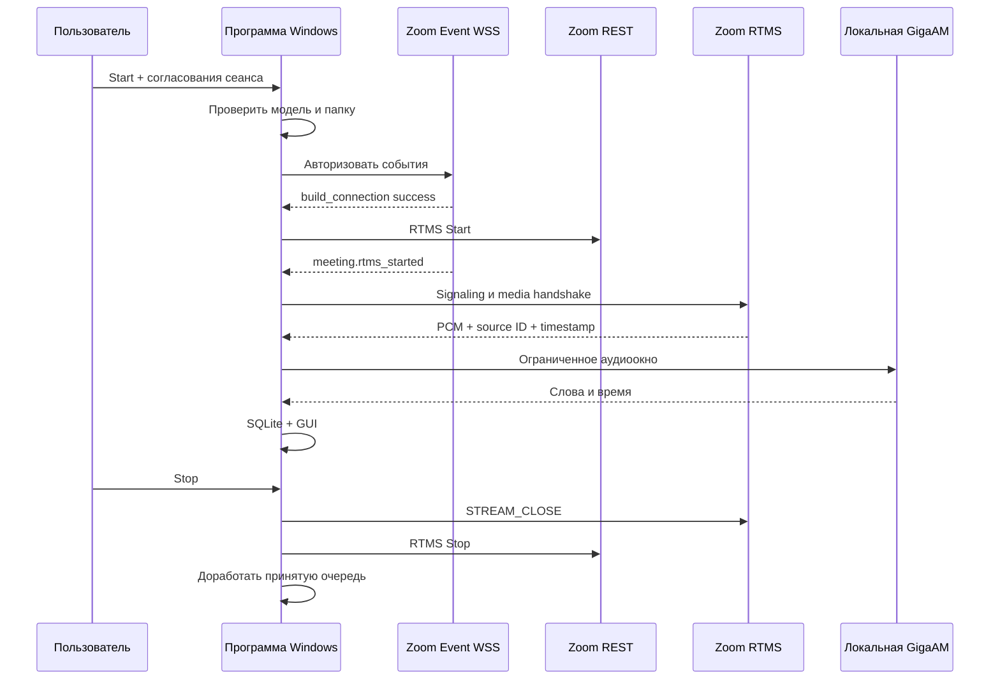
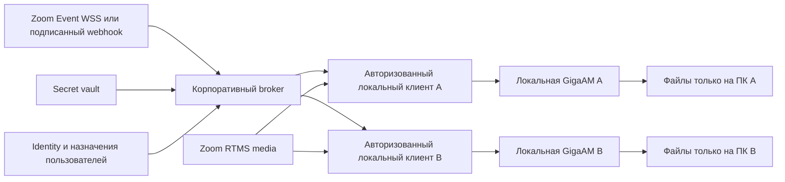

# Instructions for future in Zoom — полное руководство для следующего агента

Это дополнительный README для владельца проекта, консультирующего агента и будущего разработчика. Главная инструкция запуска остаётся в [README.md](../README.md). Здесь объяснены устройство проекта, границы проверенного результата, возможное внутреннее распространение в компании и последствия разных решений.

**Дата сверки: 17 октября 2026 года, Asia/Qyzylorda.** Аудит реализации выполнен относительно коммита [`54b07b6`](https://github.com/AssylbekGizatov/gigaam-zoom-transcriber/tree/54b07b6d8e4e4deacb353c4d28ca5cf3b5a20cde). Последующие изменения могут сделать отдельные детали устаревшими: перед действием проверяйте код, состояние аккаунта и актуальные правила Zoom.

**Статус: реализация для личного Local Test. Работа на настоящем аудио Zoom-встречи ещё не подтверждена. Корпоративная многопользовательская архитектура ниже — проект дальнейшей работы, а не уже выпущенная функция.**

В документе нет реальных Client ID, Client Secret, токенов, адреса Event WebSocket subscription, ID аккаунта, встреч, платёжных контактов и частных записей. Эти значения не нужно добавлять сюда при дальнейшем сопровождении.

## Содержание

1. [Что нужно понимать за две минуты](#brief)
2. [Что разрешено делать и где заканчивается согласование](#authorization)
3. [Что действительно готово и проверено](#status)
4. [Словарь: восемь разных смыслов слова «приложение»](#terms)
5. [Где что выполняется и хранится](#runtime)
6. [Карта всех файлов проекта](#files)
7. [Сетевые каналы и путь одного сеанса](#session)
8. [OAuth, PKCE, секрет приложения и границы доверия](#auth)
9. [Участники, имена, эпохи и таймкоды](#identity)
10. [Модель, CPU, очереди и длинные встречи](#engine)
11. [SQLite, восстановление и экспорт](#storage)
12. [Что сейчас создано в Zoom](#zoom-now)
13. [Корпоративный каталог и выдача access отдельным людям](#catalog)
14. [Что нужно изменить для нескольких компьютеров](#multiuser)
15. [Будущий интерфейс внутри Zoom](#surface)
16. [Жизненный цикл доступа сотрудника](#access)
17. [Тариф, счёт и ограничения расходов](#billing)
18. [Если меняются аккаунт, разрешения или приложение](#whatif-access)
19. [Если ломаются сеть, Start или Stop](#whatif-network)
20. [Если меняются участники и аудио](#whatif-audio)
21. [Если не хватает ресурсов или теряются файлы](#whatif-local)
22. [Приватность, отзыв доступа и удаление](#privacy)
23. [Запуск, обслуживание и диагностика](#operations)
24. [Что можно проверить без расхода RTMS](#no-rtms)
25. [Приёмка на настоящем Zoom](#acceptance)
26. [План перехода от личного теста к внутреннему продукту](#roadmap)
27. [Альтернативы RTMS и их честные ограничения](#alternatives)
28. [Как следующему агенту консультировать владельца](#agent)
29. [Ключевые внешние референсы](#references)
30. [Шаблон передачи состояния следующему исполнителю](#handoff)

<a id="brief"></a>
## 1. Что нужно понимать за две минуты

Цель — получить на Windows текст обычной Zoom Meeting: источник речи, его отображаемое имя, время и содержание. Языки: казахский, русский, английский. Распознаёт собственная локальная GigaAM Multilingual 220M CTC. Облачные STT и обязательная внешняя LLM отсутствуют.

Текущая схема: пользователь входит в Zoom обычным клиентом, отдельно запускает нашу Python/Tkinter-программу, разрешает конкретный сеанс и нажимает Start. Программа запрашивает Zoom RTMS, получает PCM с идентификаторами источников, распознаёт его и сохраняет текст на том же компьютере.

Пять принципиальных различий:

| Вопрос | Ответ для этого проекта |
| --- | --- |
| Код опубликован в GitHub — приложение уже опубликовано в Zoom? | Нет. Это независимые публикации. Сейчас публичен исходный код, Zoom-регистрация остаётся Development / Local Test. |
| Developer Pack устанавливает программу сотрудникам? | Нет. Он относится к доступу и оплате RTMS. Разрешение приложения и установка локальной программы — отдельные действия. |
| Внутренний каталог компании делает GigaAM облачной? | Нет. Каталог управляет доступностью интеграции. Место выполнения модели определяется архитектурой программы. |
| Установка интеграции в Zoom устанавливает Python, EXE или веса на ПК? | Нет. Локальный исполнитель и модель требуют отдельной доставки и запуска. |
| Приложение уже прошло полный живой тест? | Нет. Подтверждены OAuth, профиль и Event WebSocket. Настоящие lifecycle events встречи, RTMS PCM и итоговый транскрипт реальной встречи ещё не получены. |

Для первой приёмки достаточно одного согласованного оператора на одном ПК и его собственной тестовой встречи. Все участники этой встречи не обязаны становиться пользователями нашей Windows-программы: их роль может ограничиваться участием в разрешённой встрече. Поведение Zoom, согласие людей и требования хоста сохраняются.

**Не раздавайте текущие Client Secret и один Event WebSocket endpoint всем сотрудникам.** Это основной технический барьер между нынешним личным тестом и безопасным корпоративным распространением; подробности в [разделе 14](#multiuser).

<a id="authorization"></a>
## 2. Что разрешено делать и где заканчивается согласование

Исходный проект [gigaam-local-meeting-transcriber][P02] используется строго read-only. Его файлы, ветки, настройки, issues и releases нельзя менять в рамках этой задачи. Вся новая реализация и документация находятся в [gigaam-zoom-transcriber][P01].

Владелец запросил сначала личное тестирование на своём компьютере. Обсуждение каталога компании означает интерес к будущему внутреннему распространению, но само по себе не разрешает установку всем сотрудникам или изменения администраторских политик.

| Действие | Состояние / правило дальнейшей работы |
| --- | --- |
| Реализация, исправления, обычные инженерные решения, тесты и документация в новом репозитории | Разрешены в рамках задачи. |
| Четыре перечисленных ниже scope, Public Client OAuth/PKCE, локальный callback, три RTMS lifecycle subscriptions | Владелец уже явно согласовал; повторно спрашивать о тех же настройках не нужно. |
| Вход в нужный аккаунт Zoom | Выполнен владельцем; приложение авторизовано в Local Test. |
| Покупка Developer Pack, изменение тарифа, пополнение, автоплатёж | Не выполнялись. Нужны конкретные условия и явное согласование владельца / уполномоченного плательщика. |
| Первый RTMS Start с расходом кредитов | Не выполнялся. Согласие на scopes не является согласием на расход. |
| Новые scopes, постоянные разрешения, изменение security/privacy settings | Согласовать точную операцию и область действия. |
| Соглашение / новые юридические условия | Не принимать молча. |
| Add for Others, группы пользователей, распространение на компанию | Отдельно подготовить конкретный план и согласовать адресатов, права и расходы с владельцем и администратором. |
| Сообщение администратору, email, публикация от имени владельца | Этот документ не даёт разрешения отправлять сообщения. Можно подготовить текст для владельца. |
| Облачный STT, обязательная LLM, загрузка частных встреч во внешний сервис | Не соответствуют исходной цели. Не добавлять как незаметный fallback. |

Одобрение владельца нужно учитывать по существу и сохранять между этапами. Не останавливайте обычную локальную разработку ради повторного согласования уже разрешённых настроек. При блокировке доступа продолжайте независимую работу и называйте конкретный блокер.

<a id="status"></a>
## 3. Что действительно готово и проверено

### 3.1 Реализовано в исходниках

- Русский Windows GUI, вход Zoom, список предстоящих встреч или ручной ID, выбор папки.
- Public Client OAuth с PKCE и Windows DPAPI для credentials.
- Канал событий Zoom WebSocket и резервный подписанный webhook.
- Собственный адаптер документированного RTMS signaling/media протокола для Windows.
- Отдельные источники PCM, ID, имена, timestamps, reconnect и консервативные source epochs.
- Фоновая локальная GigaAM, ограниченные очереди и журнал пропусков.
- SQLite, повторное открытие сохранённого сеанса, пять форматов экспорта.
- Тесты, CI, закреплённые зависимости и лицензии.

### 3.2 Подтверждено наблюдением

| Проверка | Что доказано | Чего это не доказывает |
| --- | --- | --- |
| Полный локальный прогон: 118 тестов, 9,53 с | Проверенные сценарии кода проходят на доступном Windows-ПК | Доступность платного RTMS и совместимость с настоящим медиа-сеансом |
| [CI Windows и Linux на базовом коде][P03] | Удалённые jobs завершились успешно | Работа с настоящими credentials, моделью и Zoom-встречей |
| OAuth/PKCE callback, обмен кода, `users/me` | Настоящий вход и профиль нужной учётной записи | Разрешение любой встречи или наличие Developer Pack |
| Event WSS `build_connection`, отдельно heartbeat, кнопка проверки GUI | Zoom принимает подключение; отдельная проверка получила heartbeat ACK. Кнопка GUI проверяет build readiness | Доставка `meeting.rtms_started` и участнического PCM |
| Реальная локальная модель на разрешённых KK/RU/EN примерах | Работает CPU inference и локальный PCM-конвейер | Качество любого казахского/русского/английского разговора |
| Ускоренный soak с фиктивным ASR | Ограничения удержания памяти и SQLite на длинной временной шкале | Восемь часов настоящей Zoom-встречи или GigaAM inference |
| Визуальная проверка PDF/DOCX | Проверенные страницы отображают нужные символы и метки | Любой будущий документ любого размера |

Последний проверенный functional snapshot — `54b07b6`; новый документационный коммит может иметь другой SHA. Источники доказательств: [TESTING.md](TESTING.md), [zoom-local-test.json](evidence/zoom-local-test.json), [итоговый paced ASR](evidence/public-audio-final-paced.json), [итоговый burst ASR](evidence/public-audio-final-burst.json), [soak](evidence/soak.json), [экспорт](evidence/export-validation.json).

### 3.3 Пока отсутствует или не подтверждено

- Живой RTMS Start, настоящий `meeting.rtms_started`, PCM и транскрипт реальной Zoom-встречи.
- Подтверждённые entitlement, баланс и конкретный договор Developer Pack.
- EXE/MSI, автоматическое обновление, подпись установщика, установка через корпоративное управление устройствами.
- Веб-панель внутри Zoom, Home URL, Zoom Apps SDK UI, кнопка запуска локального исполнителя из Zoom.
- Корпоративный control plane, secret/signing broker, RBAC, реестр устройств, маршрутизация событий пользователям.
- Поддержка многих одновременных ПК с одной регистрацией приложения.
- Проверенный процесс полного удаления всех копий данных при отзыве доступа.
- Импорт локальных записей Zoom, Meeting SDK бот, захват системного звука и диаризация смешанного звука.

Начатая идея дополнительной искусственной offline-демонстрации была остановлена до создания файлов: владелец уже проверял GigaAM с микрофоном и хочет тестирование ближе к настоящему Zoom. Не описывайте такой demo/import как существующую функцию.

<a id="terms"></a>
## 4. Словарь: разные смыслы слова «приложение»

| Термин | Что это | Чего из этого не следует |
| --- | --- | --- |
| Репозиторий GitHub | Код, история, зависимости, тесты, документация | Не размещает модель на Zoom и не выдаёт сотрудникам доступ |
| Windows-программа | Python/Tkinter GUI и локальный исполнитель | Не появляется внутри Zoom как WebView автоматически |
| General App | Регистрация интеграции в Zoom Marketplace | Не является загруженным EXE или моделью |
| User-managed | Тип доступа General App, требуемый для Meetings RTMS | Не запрещает администратору устанавливать приложение отдельным пользователям |
| Admin-managed | Другой тип регистрации/доступа | Не нужно переключать RTMS app в этот тип ради корпоративной установки |
| Developer role / доступ разработчика | Права создания и настройки интеграций | Не подтверждает оплаченный Developer Pack |
| Licensed / Zoom Workplace license | Назначенные пользователю возможности Zoom | Не включает автоматически все API-продукты |
| Developer Pack | Продукт Zoom, через который предоставляются кредиты RTMS | Не распространяет нашу Windows-программу |
| Local Test | Проверка development-версии в допустимой области аккаунта | Не означает production readiness |
| Private / internal | Распространение внутри своего Zoom account | Не означает отсутствие администраторской политики или полной проверки безопасности |
| Unlisted | Установка по ссылке без публичного поиска | Не освобождает внешнее распространение от Zoom review |
| Pre-approval | Администратор разрешил добавление приложения | Пользователь ещё может не установить/не авторизовать его |
| Add for Others | Администратор добавляет и авторизует приложение выбранным пользователям | Локальный Python/EXE и веса не устанавливаются этим действием |
| In-client Surface App | Отдельный веб-интерфейс в Zoom WebView | Это не режим отображения существующего Tkinter-окна |
| Доступ к интеграции | Право использовать её под своей учётной записью | Не равно праву читать чужие локальные транскрипты |
| Доступ к встрече | Контекст конкретной встречи, политики и разрешение хоста | Не возникает из одной ссылки на встречу или из наличия лицензии |

Назначение лицензий, ролей и прав зависит от настроек аккаунта [Z21]. Не считайте слова «корпоративный контур» доказательством, что все люди принадлежат одному Zoom account: домен email, юридическое лицо, подразделение и Zoom account — разные границы.

<a id="runtime"></a>
## 5. Где что выполняется и хранится

### 5.1 Текущий личный режим



| Часть | Где работает | Какие данные видит |
| --- | --- | --- |
| Обычный Zoom client | ПК участников и инфраструктура Zoom | Обычное аудио/видео встречи согласно Zoom |
| Регистрация General App | Zoom Marketplace | Метаданные приложения, scopes, OAuth и subscription settings |
| OAuth/REST | Серверы Zoom + локальный клиент | Авторизация, профиль, встречи и управление RTMS |
| Event WSS | Zoom → локальный получатель | Lifecycle metadata, параметры доступного RTMS stream |
| RTMS signaling/audio | Zoom ↔ локальный получатель | Подпись сеанса, параметры медиа, участнический PCM |
| GigaAM | CPU и RAM компьютера оператора | Только локальные аудиоокна |
| SQLite | Выбранная локальная папка | Реплики, имена, IDs, время, события и gaps |
| Экспорт | Та же машина, выбранный пользователем путь | Итоговый текст и структурированные данные |
| GitHub | GitHub | Публичный код и обезличенные результаты разрешённых тестов |
| Корпоративный broker | Сейчас отсутствует | В будущем только явно согласованные служебные данные |

«Локальное распознавание» не означает, что Zoom-встреча работает без сети: исходное аудио проходит инфраструктуру Zoom. Внешний облачный STT/LLM в этой цепочке отсутствует. Источники уже скачанных моделей и первоначальная установка зависимостей также требуют отдельного сетевого этапа.

### 5.2 Конкретные местоположения

| Объект | Место |
| --- | --- |
| Исходники | Папка нового репозитория |
| Окружение Python | `.venv/`, создаётся локально, исключено из Git |
| Модель | Выбранный `model_dir`; типовой путь `models/gigaam`, но можно читать существующую проверенную папку |
| Публичные настройки | `%LOCALAPPDATA%/GigaAMZoom/settings.json` |
| Credentials | `%LOCALAPPDATA%/GigaAMZoom/credentials.dpapi` |
| SQLite сеанса | Выбранный `export_dir`, имя `Zoom_<дата>_<время>_<случайный суффикс>.sqlite` |
| SQLite sidecar | Рядом могут существовать `-wal` и `-shm` |
| Экспорт | Пользователь выбирает путь через Save dialog |
| Исходный PCM | Приложение удерживает в ограниченных RAM-буферах, не создаёт постоянную аудиозапись |

Все копии приложения под одним Windows-пользователем используют один этот каталог настроек. Профили по приложению/tenant/device и межпроцессные блокировки сейчас не реализованы. Два процесса могут конфликтовать; это не поддержанный способ вести две встречи одновременно.

<a id="files"></a>
## 6. Карта всех файлов проекта

Карта относится к функциональному snapshot `54b07b6`. Не нужно читать бинарный шрифт как исходник. Полный список всегда можно получить командой `git ls-files`.

### 6.1 Вход, упаковка и зависимости

| Файл | Назначение / последствия изменения |
| --- | --- |
| [app.py](../app.py) | Точка входа GUI; Run из IDE вызывает главное окно |
| [pyproject.toml](../pyproject.toml) | Имя/версия проекта и pytest settings; Python `>=3.12,<3.13` |
| [setup.ps1](../setup.ps1) | Создаёт `.venv`, ставит CPU Torch/Torchaudio и ASR зависимости; не покупает Zoom и не запускает RTMS |
| [start.ps1](../start.ps1) | Запускает `app.py` из окружения; требует предварительную установку |
| [requirements-core.txt](../requirements-core.txt) | NumPy, websockets, psutil, python-docx, ReportLab и зависимости экспорта |
| [requirements-asr.txt](../requirements-asr.txt) | Core и GigaAM из закреплённого Git commit |
| [requirements-dev.txt](../requirements-dev.txt) | Core, pytest, pypdf; CI не устанавливает тяжёлую модель |
| [constraints.txt](../constraints.txt) | Закреплённые версии; менять согласованно с requirements и измерениями |
| [.gitignore](../.gitignore) | Исключает окружение, модель, аудио, SQLite, credentials и runtime artifacts |
| [LICENSE](../LICENSE) | MIT для кода с сохранением upstream уведомления |
| [NOTICE.md](../NOTICE.md) | Происхождение модели/кода/шрифтов и лицензии компонентов |

### 6.2 Основные Python-модули

| Файл | Ответственность | Чего в нём нет |
| --- | --- | --- |
| [gigaam_zoom/__init__.py](../gigaam_zoom/__init__.py) | Пакет приложения | Сервисного backend |
| [gui.py](../gigaam_zoom/gui.py) | Tkinter, вкладки, поля, статусы, последние 500 реплик, действия пользователя | Inference и сетевых ожиданий на Tk thread |
| [controller.py](../gigaam_zoom/controller.py) | Один сеанс, фоновые потоки, порядок Start/Stop, связывание transport и pipeline | Планировщика многих встреч, distributed locks |
| [auth.py](../gigaam_zoom/auth.py) | PKCE, token exchange/refresh, профиль, meetings, REST RTMS Start/Stop | Billing API, покупки, корпоративной ACL |
| [config.py](../gigaam_zoom/config.py) | Settings, локальные пути, разбор meeting ID, origin, DPAPI | Реестра tenant/device, централизованного vault |
| [events.py](../gigaam_zoom/events.py) | Event WSS, build readiness, heartbeat, reconnect, резервный HMAC webhook | Fan-out всем сотрудникам и durable replay |
| [rtms.py](../gigaam_zoom/rtms.py) | WSS handshake, HMAC, PCM decoding, endpoint validation, keepalive, reconnect, stop ACK | REST покупки/Start и самого ASR |
| [models.py](../gigaam_zoom/models.py) | Неизменяемые контракты `AudioPacket`, `Word`, `Segment`, `Gap` | Поиска личности по голосу |
| [pipeline.py](../gigaam_zoom/pipeline.py) | Per-source окна, overlap, один worker, бюджет PCM, слова → финальные реплики | Неограниченной очереди и доказанного real-time для любого CPU |
| [engine.py](../gigaam_zoom/engine.py) | Проверка модели, загрузка CPU, локальный CTC и word timestamps | Внешнего STT, LLM, автоматического model-hub fallback |
| [store.py](../gigaam_zoom/store.py) | SQLite schema, реплики, метаданные, участники, gaps, чтение порциями | Записи PCM, шифрования всей БД и восстановления потерянного звука |
| [exports.py](../gigaam_zoom/exports.py) | TXT/MD/JSON/DOCX/PDF, Unicode, безопасное создание файлов, limits | Автоматической отправки отчётов другим людям |

### 6.3 Скрипты, CI и тесты

| Файл | Назначение |
| --- | --- |
| [scripts/acquire_model.py](../scripts/acquire_model.py) | Явная первоначальная загрузка закреплённых файлов модели с проверкой SHA256 |
| [scripts/evaluate.py](../scripts/evaluate.py) | Реальная локальная модель на разрешённых WAV fixtures; throughput/latency/CPU/RAM; Zoom не запускает |
| [scripts/soak.py](../scripts/soak.py) | Ускоренная длинная PCM-шкала с fake ASR; проверяет удержание данных, не реальную восьмичасовую встречу |
| [scripts/import_credentials.py](../scripts/import_credentials.py) | Локальный импорт из stdin, ограничение 8 KiB, DPAPI; секреты не передаются через argv |
| [scripts/check_publication.py](../scripts/check_publication.py) | Проверяет tracked files на runtime artifacts и известные credential patterns |
| [.github/workflows/ci.yml](../.github/workflows/ci.yml) | Windows/Linux, публикационный guard, pytest, JUnit artifacts; GitHub permissions `contents: read` |
| [tests/test_config_auth_events.py](../tests/test_config_auth_events.py) | Settings, пути, OAuth, подписи и события |
| [tests/test_event_websocket.py](../tests/test_event_websocket.py) | Build readiness, heartbeat, renewal, retries, stop, безопасные ошибки, TLS loopback |
| [tests/test_controller.py](../tests/test_controller.py) | Жизненный цикл, отмена, lost Start response, event-gap до медиа и Stop |
| [tests/test_rtms.py](../tests/test_rtms.py) | Протокол, PCM, timestamps, source epochs, endpoint policy, reconnect и TLS loopback |
| [tests/test_pipeline.py](../tests/test_pipeline.py) | Окна, overlap, нагрузки, gaps, имена/источники, ошибки ASR/Store |
| [tests/test_store.py](../tests/test_store.py) | SQLite schema, устойчивые финальные записи и чтение |
| [tests/test_exports.py](../tests/test_exports.py) | Форматы, Unicode, timestamps, secrets, streaming/limits, запрет перезаписи |
| [tests/test_setup_credentials.py](../tests/test_setup_credentials.py) | Смена app IDs очищает старые OAuth tokens; неверные настройки и импорт не раскрывают секреты |

### 6.4 Документация, доказательства и шрифт

| Файл / группа | Назначение |
| --- | --- |
| [README.md](../README.md) | Краткий пользовательский запуск; не заменять этим большим handoff |
| [ARCHITECTURE.md](ARCHITECTURE.md) | Основная карта существующих потоков |
| [ZOOM_SETUP.md](ZOOM_SETUP.md) | Личная настройка и ежедневный Local Test; это не инструкция массового развёртывания |
| [ZOOM_RESEARCH.md](ZOOM_RESEARCH.md) | Выбор RTMS, альтернативы и ограничения |
| [PRIVACY.md](PRIVACY.md) | Локальные файлы, секреты, данные и ограничения удаления |
| [TESTING.md](TESTING.md) | Проверки, оборудование, методики и пределы выводов |
| [evidence/zoom-local-test.json](evidence/zoom-local-test.json) | Обезличенные реальные OAuth/Event WSS результаты |
| [evidence/pricing-verification.json](evidence/pricing-verification.json) | Снимок проверки публичной ставки; не договор аккаунта |
| [evidence/export-validation.json](evidence/export-validation.json) | Визуальная проверка DOCX/PDF и ограничения форматов |
| [evidence/soak.json](evidence/soak.json) | Измерения ускоренного fake-ASR soak |
| `evidence/public-audio-burst.json`, `public-audio-burst-fresh.json`, `public-audio-paced.json` | Исторические прогоны; не выбирать только удобные результаты |
| `evidence/public-audio-final-burst.json`, `public-audio-final-paced.json` | Итоговая проверка после изменения overlap |
| [fonts/DejaVuSans.ttf](../fonts/DejaVuSans.ttf), [fonts/LICENSE.txt](../fonts/LICENSE.txt) | Встроенный Unicode-шрифт PDF и его лицензия |
| Этот файл | Консультационный handoff: устройство, будущий Zoom, сценарии и источники |

Скрипт публикационной проверки дополняет ручную проверку, но не является универсальным DLP/secret scanner. Он не доказывает отсутствие любого секрета в любой истории Git.

<a id="session"></a>
## 7. Сетевые каналы и путь одного сеанса

### 7.1 Не путать три WebSocket-соединения

| Канал | Для чего | Авторизация | Содержит звук? |
| --- | --- | --- | --- |
| Zoom Event WebSocket | Сообщить о готовом/остановленном/прерванном RTMS stream | Отдельный `client_credentials` token General App | Нет, только служебные события |
| RTMS signaling WSS | Подключение и состояние медиа-сеанса, участники, адрес media server | Подпись конкретного stream | Не основной PCM transport |
| RTMS audio WSS | Пакеты PCM16 с ID, именем, timestamp | Подпись и media handshake | Да |

Успех первого канала не доказывает успех второго или третьего. Generic Event WSS — account-bound [Z08]. Порядок RTMS handshake описан отдельно [Z03].

Основной личный режим использует исходящие TLS/WSS-соединения. OAuth callback кратковременно слушает `127.0.0.1` на случайном порту. Публичный входящий порт и туннель для текущего Event WSS режима не нужны.

Коннекторы агента не входят в runtime приложения. В использованном сеансе Zoom-коннектор предоставлял инструменты работы с материалами/встречами, а не настройку Developer Marketplace и не выдачу PCM нашему процессу. Поэтому регистрацию настраивали в официальном браузере, а программа подключается к Zoom своими OAuth/REST/WSS-модулями. GitHub-коннектор/CLI нужны для доставки кода; установленная Windows-программа от них не зависит. Доступность инструментов будущего агента нужно проверить заново, не считать их присутствие лицензией RTMS.

Для HTTP OAuth/REST код принимает только `https://zoom.us` и `https://api.zoom.us`, не следует redirect. RTMS endpoints проверяются на `wss`, порт 443 и домен Zoom; адреса повторно проверяются при redirect. Event subscription URL ограничен `ws.zoom.us/ws?subscriptionId=...`, без сохранённого access token. Сетевые ошибки не должны печатать bearer URLs и тела credential-bearing ответов.

### 7.2 Последовательность Start

1. Проверить, что предыдущий сеанс закончен, папка локальная, IDs и модель заданы.
2. Требовать две непостоянные галочки: согласие на обработку встречи и разрешение расхода RTMS для этого сеанса.
3. Проверить SHA256 и загрузить модель в фоне. Если пользователь отменил запуск во время загрузки, RTMS не стартует.
4. Создать SQLite и pipeline, подготовить канал событий.
5. Для Event WSS ждать не просто TCP/TLS, а успешный `build_connection`. Проверяются также Stop и завершение event task.
6. Только после этого отправить REST `PATCH .../rtms_app/status`, `action: start`, с user OAuth token.
7. Получить `meeting.rtms_started`, отфильтровать по встрече и сохранить UUID/stream context.
8. Открыть signaling, подписать handshake, открыть media, согласовать audio-only individual PCM.
9. Подать PCM в ограниченную очередь и inference worker. GUI получает события и читает свежие реплики из SQLite.

На Event WSS readiness отведено 20 с, на ожидание первого lifecycle event после принятого Start — 40 с. Это пределы текущего приложения, а не гарантии сроков Zoom. HTTP-запросы имеют собственные таймауты. [Controller](../gigaam_zoom/controller.py) остаётся источником истины после изменений.



### 7.3 Последовательность Stop и отказов

До REST Start контроллер заранее отмечает, что Start мог уйти: потерянный HTTP-ответ не доказывает, что Zoom ничего не запустил. В `finally` выполняются попытка протокольного закрытия и REST Stop. Ошибка подтверждения выводит явное требование проверить Active Apps и остановить приложение вручную.

Если канал событий потерян после его авторизации, но до подключения медиа, запуск прерывается. Уже отправленный REST Start сначала получает результат, затем идёт Stop — параллельная гонка Start/Stop не создаётся. После установленного медиа краткая потеря Event WSS отмечается в журнале, а медиа не обрывается немедленно только по этому признаку.

После закрытия аудиоприёма обрабатывается уже принятая очередь. Успешное опустошение очереди означает обработку принятых данных, а не доказательство полноты всей встречи. При disk/inference failure нельзя выдавать успешный drain за полный транскрипт.

Ошибки здесь различаются. Ошибка SQLite помечает pipeline как неуспешный и вызывает остановку. Исключение ASR одного окна сейчас записывает gap `inference_failed`, сообщает об ошибке фрагмента и позволяет обрабатывать следующие окна. Поэтому после такой потери возможен итоговый статус `drained`: это не доказательство, что весь принятый PCM распознан. В коде также есть несогласованность имён: fatal-list контроллера содержит `inference_error`, а pipeline отправляет `inference_failed`. Следующему разработчику нужно явно выбрать политику partial/fatal ASR и согласовать события, статус и тесты; в этом документационном изменении поведение программы не исправлялось.

Кнопки Pause/Resume, хотя такие действия существуют в Zoom API, в текущем GUI/API wrapper не реализованы. Не описывайте их как готовые.

<a id="auth"></a>
## 8. OAuth, PKCE, секрет приложения и границы доверия

### 8.1 Три разные идентичности

1. **Пользователь Zoom:** OAuth token относится к подключённой учётной записи и согласованным scopes.
2. **Регистрация General App:** обычный Client ID и Client Secret нужны confidential операциям, Event WSS и RTMS подписи.
3. **Участник / источник встречи:** RTMS `user_id` определяет источник PCM; это не обязательно постоянный account user ID.

Не подменяйте одну идентичность другой. Знание meeting ID не авторизует доступ к встрече. Имя участника не авторизует доступ к чужому тексту.

### 8.2 PKCE пользователя

`auth.py` генерирует verifier/challenge S256 и случайный state. Браузер проходит официальный Zoom OAuth. Временный `127.0.0.1:<port>/callback` принимает ответ только с правильным state. Код обменивается на tokens через Public Client ID без Client Secret. Refresh делается перед истечением access token, значения ротируются в vault.

Обычный Client ID и Public Client ID — разные поля. Нельзя менять их местами. Разрешение loopback для этого native OAuth потока не означает, что любой localhost HTTP API автоматически безопасен или поддержан внутри будущего Zoom WebView [Z09], [Z10].

### 8.3 Почему Client Secret всё ещё существует

Event WSS использует `client_credentials`. RTMS handshake подписывается HMAC от Client ID, meeting UUID и stream ID. Эти confidential операции в текущей программе выполняются локально с Client Secret. PKCE решает задачу OAuth пользователя, а не автоматически все способы авторизации приложения [Z08], [Z11], [Z03].

Для одного владельца тестовой регистрации это осознанная граница Local Test. Для массового распространения одного корпоративного приложения раздавать такой общий секрет в EXE, конфиге или DPAPI-файле нельзя. Пользователь/программа с правами того же Windows-пользователя может получить секрет из работающего процесса. Обфускация и упаковка EXE этого не исправляют.

### 8.4 Что защищает DPAPI

Credentials хранятся в Windows user scope с запретом интерактивного UI. DPAPI защищает сохранённые байты от обычного чтения вне контекста пользователя. Это не защита от скомпрометированной Windows, администратора машины или кода, работающего с правами того же пользователя.

В `GUI.save` сначала проверяется кандидат Settings. При смене Client ID или Public Client ID старые OAuth tokens очищаются в одном обновлении vault вместе с секретами; ротация секрета при той же идентичности приложения может сохранить user tokens. Import script придерживается того же правила. **Это атомарное обновление файла credentials, но не общая транзакция между `settings.json` и `credentials.dpapi`.** При ошибке записи настроек нужно повторно проверить согласованность.

Сохранённый вход можно восстановить при запуске GUI через `users/me`. Поле «Аккаунт подключён» подтверждает пользовательский OAuth, а не доступность RTMS в выбранной встрече.

<a id="identity"></a>
## 9. Участники, имена, эпохи и таймкоды

### 9.1 Контракты данных

| Контракт | Поля и смысл |
| --- | --- |
| `AudioPacket` | `user_id`, `user_name`, `timestamp_ms`, `pcm`, `sample_rate`, `epoch` |
| `Word` | Локальные `start`, `end`, `text` из модели |
| `Segment` | `id`, `speaker_id`, `display_name`, `start`, `end`, `text`, `status`, `source_epoch` |
| `Gap` | `speaker_id`, `start`, `end`, `reason`, `source_epoch` |

Эти поля определены в [models.py](../gigaam_zoom/models.py). Схема предусматривает `preliminary` и `final`, но текущая оконная CTC-публикация выдаёт финальные реплики. Пословная предварительная гипотеза не симулируется.

### 9.2 Правила источников

Zoom PCM несёт ID, имя и серверный timestamp. Смешанному аудио соответствует ID `0` [Z04]. Код связывает текст с источником, а не с предполагаемой личностью.

- Одинаковое имя у двух людей: разные ID остаются разными источниками.
- Переименование: старые реплики сохраняют прежнее имя; новый снимок применяется дальше.
- Выход и повторный вход: при наблюдаемой последовательности leave → join создаётся новая эпоха; объединение по имени/голосу не выполняется. Без доставленных метаданных нельзя обещать обнаружение каждого повторного входа.
- Новый RTMS stream или успешное новое signaling generation: source epoch меняется. Media-only reconnect сохраняет текущую эпоху и cursor, а обнаруженный пропуск журналируется; не каждый сетевой retry создаёт новую личность/эпоху.
- Общий микрофон: несколько людей остаются одним Zoom-источником. Фраза «это точно Иван» на основании голоса недопустима.
- Потеря имени: используется явная неизвестность/служебная метка; нельзя назначать знакомое имя по догадке.
- Долгосрочная корпоративная личность: не строится из одного RTMS `user_id`. Для такой задачи потребуется отдельная разрешённая схема identity mapping.

### 9.3 От чего считается время

`start/end` реплики получаются из timestamp PCM окна и word timestamps модели. Это приближённые границы, а не сертифицированная стенограмма.

| `time_basis` | Значение | Условие |
| --- | --- | --- |
| `meeting` | От фактического начала всей встречи | Начало явно введено пользователем / передано как проверенный origin |
| `rtms_session` | От начала RTMS-сеанса | Использован origin signaling, без знания более ранней части встречи |
| `first_audio` | От первого доступного аудио | Официальный origin не получен |

Позднее включение RTMS не восстанавливает предыдущую часть встречи. Запланированное время в календаре не является доказательством фактического старта. В GUI фактическое начало вводится в формате `ДД.ММ.ГГГГ ЧЧ:ММ:СС`, фиксированное UTC+05:00; автоматического выбора timezone сейчас нет.

Reconnect не обнуляет часы. Если известен только факт разрыва, gap может иметь неизвестную длительность / маркер нулевой ширины. Нельзя преобразовывать такой маркер в выдуманное количество секунд потерянной речи.

<a id="engine"></a>
## 10. Модель, CPU, очереди и длинные встречи

Модель: GigaAM Multilingual 220M CTC, CPU float32. Код GigaAM закреплён на `7447938d791c4f3e643386ee22c33777004293a5`, модель — на revision `2f8a57144e6ec3adfd32fe0484d9ea9913305bc8`. SHA256 и лицензии перечислены в [NOTICE.md](../NOTICE.md).

Загрузчик проверяет config и веса, ограничивает допустимые `_target_` и использует `weights_only=True`. Во время встречи нет автоматической загрузки отсутствующей модели, `trust_remote_code`, обращения к внешнему STT или LLM. `acquire_model.py` — отдельное явное действие первоначальной настройки.

| Параметр | Текущая реализация |
| --- | --- |
| RTMS audio | PCM16 little-endian, mono, 16 kHz, individual, `data_opt=2`, send rate 20 ms |
| RTMS individual-ограничение | Параметры Zoom не обещают произвольное число одновременно говорящих источников; сверять [Z05] |
| Окно pipeline | До 8 с |
| Перекрытие | 2 с; шаг полного окна около 6 с |
| Silence / idle flush | По умолчанию около 1,2 с |
| Inference workers | Один |
| CPU threads GigaAM | До четырёх, ограничены числом логических CPU |
| Общий бюджет PCM | До 48 с суммарной работы / буферов, не 48 с на каждого участника |
| Число активных source states | До 128 |
| Event WSS | Body до 64 KiB, очередь 8, heartbeat 30 с, плановое обновление token примерно через 3300 с |
| RTMS transport | Сообщение до 256 KiB, очередь 16, один декодированный PCM-пакет до 32 000 байт / 1 с |
| Очередь GUI | 256 событий |
| Видимые реплики GUI | Последние 500 |
| Очередь lifecycle событий Controller | 64 |
| SQLite cache | 2 MiB; чтение сегментов порциями |

Сам `engine.py` ограничивает отдельный вход 300 секундами и делит его внутренними окнами около 24 с. В обычном RTMS-режиме до него доходят более короткие pipeline-окна до 8 с. Это ограниченная функция движка, а не существующий пользовательский импорт произвольной аудиозаписи.

Увеличение overlap выбрано после реального обнаружения повтора на казахском шве. Код удаляет повторы в контексте пересечения PCM/таймкодов, а не любое одинаковое слово: настоящее повторение слов должно сохраниться.

Если CPU не успевает, очередь не растёт без ограничения: часть новых данных отклоняется и фиксируется gap. Три одновременных источника создают больше работы, чем один. Буфер в секундах аудио нельзя считать количеством секунд гарантированной задержки или объёмом поддерживаемой встречи.

### Проверенные измерения и их масштаб

На Windows 11 / Intel Core i5-10300H / 8 logical CPU / 7,84 GiB RAM реальная модель загрузилась примерно за 13,4 с. В итоговом burst-прогоне искусственно объединённых 29,775 с речи pipeline занял около 4,42 с: RTF около 0,148, CPU около 48,4% всей машины, peak RSS около 1914 MiB. В paced-прогоне локальный callback финального текста отставал от конца реплики примерно на 1,49–2,93 с; это не включает Zoom, сеть и перерисовку GUI.

На отдельных маленьких KK/RU/EN clips итоговый WER был 0; на искусственной склейке — 3,85%. Это smoke test на нескольких десятках слов. Нельзя рекламировать такую цифру как точность реальных совещаний, шумных микрофонов, естественного code-switching или одновременной речи.

Ускоренный fake-ASR soak обработал восьмичасовую шкалу за 45,755 с; 7200 сегментов, без отказов пакетов/overload drops, RAM после прогрева около 34,54 → 34,64 MiB. В журнале при этом были транспортные gaps сгенерированной шкалы. «Нет drops» не означает «нет gaps», и это не восьмичасовая проверка GigaAM/Zoom. Методики и исходные числа — [TESTING.md](TESTING.md).

<a id="storage"></a>
## 11. SQLite, восстановление и экспорт

SQLite нужен для постепенной фиксации реплик и ограниченного чтения. Это встроенный файл, не отдельный сервер БД. Таблицы: `metadata`, `segments`, `gaps`, `participant_events`, `source_cursors`. Используются WAL, `synchronous=FULL`, индекс по времени и проверка неизменяемости финальных реплик.

Финальный сегмент с тем же содержимым можно повторно доставить идемпотентно; переписать его другим текстом нельзя. Для будущего редактора исправлений нужна отдельная версия/история, а не молчаливое изменение этого инварианта.

«Восстановить сеанс» сейчас значит открыть уже сохранённый SQLite и экспортировать его. Это не возобновление RTMS, не восстановление RAM PCM после сбоя и не гарантированный ремонт повреждённой БД. Новый Start создаёт новый файл.

Кнопка открытия использует обычный `Store`, который выполняет schema/metadata initialization. Это не forensic read-only viewer и не обещание побитовой неизменности архивного файла. Для неизменяемого архива работать с согласованной копией либо отдельно реализовать настоящий SQLite read-only режим и проверку версии схемы.

| Формат | Как создаётся | Ограничение |
| --- | --- | --- |
| TXT | Последовательное чтение записей | Подходит для очень длинного текста |
| Markdown | Последовательное чтение с escaping | Не HTML-публикация и не автоматическая отправка |
| JSON | Схема, metadata, timing basis, segments, participants, events/gaps | Содержит идентификаторы и потому является данными встречи |
| DOCX | `python-docx`, Unicode | Дерево документа в RAM; ограничение около 2 млн символов |
| PDF | ReportLab, DejaVu Sans | Максимум 1000 страниц; библиотека удерживает часть структуры PDF |

Экспорт использует исключительное создание `x/xb`: существующий файл не заменяется. При превышении лимитов предлагается TXT/JSON. Сбой удаляет только новый частичный экспорт, а не исходный SQLite.

Фильтр metadata исключает ключи вроде token/secret/password, в том числе во вложенной структуре экспорта. Он не удаляет секрет, произнесённый человеком и попавший в текст, и не доказывает, что произвольное значение под безобидным ключом безопасно. Не используйте этот фильтр как основание публично выкладывать реальные транскрипты.

Копирование работающей SQLite одной командой без учёта WAL может потерять последние записи в копии. Для операционного backup сначала штатно завершите сеанс и закройте файл либо реализуйте штатный SQLite backup API. Автоматический backup/retention manager в проекте не поставляется.

<a id="zoom-now"></a>
## 12. Что сейчас создано в Zoom

Создана регистрация **GigaAM Zoom Local**, General App, **User-managed**, Development / Local Test. Это настройка доступа и протоколов, не загруженный Python-код, EXE или веса GigaAM.

Сохранены четыре scope:

| Scope | Использование |
| --- | --- |
| `meeting:read:meeting_audio` | RTMS audio |
| `meeting:update:participant_rtms_app_status` | REST Start / Stop |
| `user:read:user` | Определить подключённый профиль |
| `meeting:read:list_meetings` | Показать предстоящие встречи текущего пользователя |

Сохранены Event WebSocket subscriptions `meeting.rtms_started`, `meeting.rtms_stopped`, `meeting.rtms_interrupted`. Включён Public Client OAuth/PKCE и loopback callback. Вход и Event WSS проверены, включая heartbeat.

Не выполнялись публикация во внешний Marketplace, bulk install сотрудникам, запуск платного RTMS, покупка тарифа и включение auto-start. Публичный GitHub на это не влияет. Доступность account/group/user setting передачи meeting content ещё нужно проверять с уполномоченным администратором перед реальным тестом.

Для RTMS Meetings General App должен оставаться **user-managed** [Z02]. Корпоративное назначение пользователям не требует превращать его в admin-managed или добавлять admin scopes.

<a id="catalog"></a>
## 13. Корпоративный каталог и выдача access отдельным людям

### 13.1 Что значит «добавить в портфель приложений компании»

Это может означать разные операции: разрешить приложение, сделать доступной внутреннюю карточку, дать ссылку установки, установить за выбранных пользователей или развернуть сам Windows-клиент. Перед действием нужно назвать конкретную операцию, а не объединять всё словом access.

Private app предназначен для пользователей того же Zoom account. Внутреннее использование не требует стандартной публичной Marketplace review, но сохраняет корпоративное согласование и платформенные ограничения [Z12]. Внешний beta-доступ и unlisted/public — другие режимы с дополнительными процедурами [Z13], [Z14].

Public и unlisted apps проходят App Review. Для внешнего beta требуется отдельное одобрение Zoom / Request to Share и ограниченная по сроку ссылка. Для RTMS перед добавлением пользователей вне своего account отдельно сверить применимый путь review; Local Test, unlisted и beta нельзя считать обходом проверки [Z34], [Z13], [Z14].

Добавление карточки/интеграции не меняет место inference. Модель и документы могут остаться на ПК. Защищённый внутренний каталог не равен физическому размещению всех компонентов внутри корпоративной сети: сама Zoom Meeting и RTMS остаются сервисами Zoom.

### 13.2 Четыре разных вида access

| Вид доступа | Кто выдаёт | Результат | Статус в нашем коде |
| --- | --- | --- | --- |
| Доступ разработчика к настройкам app | Владелец/администратор Zoom | Возможность менять регистрацию/credentials | Не раздавался другим людям |
| Pre-approval | Marketplace admin | Разрешает пользователю добавить app | Корпоративная настройка вне приложения |
| Add for Others / индивидуальный OAuth | Админ / сам пользователь | Устанавливает и авторизует Zoom-интеграцию | Проверен индивидуальный OAuth владельца; корпоративное назначение не тестировалось |
| Разрешение конкретной встречи | Политики Zoom и хост, согласие людей | Допуск к содержимому этой встречи | Живой сценарий ещё не проверен |
| Запуск локального исполнителя | Пользователь/IT на Windows | Есть процесс, модель, RAM и локальная папка | Реализован ручной запуск из IDE |
| Доступ к итоговому документу | Владелец локального файла / политика компании | Чтение конкретного транскрипта | Централизованная раздача результатов отсутствует |

### 13.3 Что может сделать администратор

Администратор может одобрить user-level app и отдельно добавить его выбранным пользователям или группам [Z15], [Z16]. RTMS-документация описывает путь Marketplace → Manage → Apps on account → приложение → Users & Groups → Add Users [Z02]. Названия экранов нужно сверять с текущим UI и ролью администратора.

Для пилота лучше выбрать конкретных пользователей: назначение на весь аккаунт или группу может охватывать будущих членов автоматически. Одобрение означает доступность установки, Add for Others — установку/авторизацию в Zoom; это разные эффекты. Оно всё равно не ставит локальную модель и не создаёт персональные OAuth tokens в DPAPI нашей программы.

Нельзя считать, что после администраторского Add for Others существующий PKCE-клиент сам получил нужные runtime credentials. Desktop login/bootstrap для такого provisioning нужно отдельно спроектировать и проверить.

### 13.4 Последовательность разумного внутреннего пилота

1. Подтвердить entitlement и условия Developer Pack у плательщика.
2. Завершить один живой тест текущей single-operator версии.
3. Выбрать архитектуру секретов и событий из [раздела 14](#multiuser).
4. Подготовить отдельную пилотную регистрацию/среду и конкретный список пользователей, прав и лимитов.
5. Согласовать администраторское добавление, контентные разрешения и доставку Windows-клиента.
6. Проверить установку, OAuth/bootstrap, отмену назначения, два ПК и две встречи.
7. Только после приёмки расширять доступ.

Эти пункты — план. Этот README не устанавливает приложение сотрудникам и не является одобрением плательщика.

<a id="multiuser"></a>
## 14. Что нужно изменить для нескольких компьютеров

### 14.1 Почему нельзя просто скопировать текущую папку

1. Один корпоративный Client Secret не должен оказываться у всех сотрудников [Z11].
2. Event WSS subscription не является каналом рассылки на каждый ПК. Сотрудник Zoom описывал обычное ограничение: один активный consumer на subscription; второй может вытеснять первый. Ответ относится к 2024 году, точные текущие квоты нужно перепроверить, но архитектуру нельзя строить на предположении неограниченного fan-out [Z17]. Это не утверждение «в аккаунте разрешён только один любой WebSocket».
3. Канал account-bound не предназначен для Marketplace multi-tenancy во внешних аккаунтах [Z08].
4. В программе один Controller и одна активная встреча. Нет распределённого владения сеансом, координации Stop и защиты от запуска второго процесса.
5. Настройки/credentials не разделены по app/tenant/device. Копирование ciphertext DPAPI на другой Windows-профиль не является переносом авторизации.
6. Отзыв назначения в каталоге пока не связан с надёжным прекращением локального inference и жизненным циклом всех файлов.

Даже два приложения «Проверить события Zoom» и «Активная встреча» с одним subscription на разных ПК могут мешать друг другу. Не проводить такой эксперимент на важной встрече.

### 14.2 Вариант A: один оператор — минимальное продолжение

**Состояние: соответствует нынешней направленности, но живой Zoom ещё не проверен.** Один доверенный владелец app запускает один desktop process. Остальные люди просто участвуют во встрече с необходимыми разрешениями. Только оператор получает локальный транскрипт.

Это подходит для первой проверки и сценария «я веду встречи и делаю текст у себя». Внутреннее одобрение app может быть частью управления компанией, но не делает всех участников операторами. Один оператор не решает запрос «каждый сотрудник независимо получает собственный текст».

### 14.3 Вариант B: отдельная собственная app каждого оператора

**Состояние: возможная инженерная модель для независимых пилотов, не реализованный массовый процесс.** Каждый оператор управляет своей регистрацией/credentials и subscription. Не нужно раздавать один общий secret.

Минусы: много настроек, отдельные разрешения, управление жизненным циклом регистраций, возможные ограничения Zoom и общий/разный биллинг. Несколько регистраций не доказывают, что секреты или тариф изолированы на уровне отдельного физического человека. Плательщика и границы account нужно подтвердить. Такой путь неудобен как корпоративный пользовательский продукт.

### 14.4 Вариант C: корпоративный control plane, локальный PCM и ASR

**Состояние: рекомендуемое направление проектирования общего корпоративного приложения; ещё не написано и не проверено с Zoom.** Потребуется доверенный broker/signing service, размещённый в согласованной инфраструктуре компании.



Цель схемы — общий secret и событие остаются в доверенной части, а media может идти из Zoom непосредственно на допущенный ПК. Сервис не должен получать PCM или транскрипт, если владелец не согласовал такую передачу. Подписи конкретного stream, stream URLs и связь «человек—встреча—устройство» сами являются чувствительными служебными данными.

Нужные новые компоненты:

- Идентификация tenant, пользователя и устройства; SSO/Zoom mapping без доверия отображаемому имени.
- Allowlist/назначения отдельных пользователей и минимальные права.
- Один управляемый consumer на subscription, проверка подлинности событий, routing только разрешённому клиенту.
- Проверенное соответствие user OAuth и конкретного RTMS-сеанса; не выдавать метаданные чужой встречи по заявленному `meeting_id`.
- Хранилище общего Client Secret на сервере, ротация и ограниченный signing API.
- Новый интерфейс transport: получать подпись/контекст через защищённый provider вместо `_secret` в каждом `RTMSClient`.
- TLS, аутентификация клиента, защита от replay, журналирование без bearer values и private payload.
- Lease/heartbeat/ownership для сеанса и устройства; определённое поведение при уходе ПК, broker outage и отказе Stop.
- Координация повторных запусков, лимиты сеансов и согласованная реакция при недоступности контроля расходов.
- Механизм отзыва, обновления клиента, операционная поддержка и минимальные аудит-события.

Подпись RTMS связана с контекстом stream, но действующая спецификация HMAC не содержит самостоятельно выбранного нами срока годности. Нельзя просто назвать выданную подпись «одноразовым токеном на 60 секунд» и считать безопасность решённой. TTL, replay и отзыв ограничиваются собственным протоколом выдачи, разрешениями Zoom и жизненным циклом stream; это требует прототипа и проверки.

При отказе брокера приложение должно иметь согласованное поведение: например, запрет новых Start, остановка или короткая управляемая отсрочка уже активного сеанса. Политика не должна оставлять оплачиваемый поток бесконтрольно работающим. Сам по себе broker не даёт жёсткий банковский лимит Zoom.

### 14.5 Вариант D: всё распознавать на общем сервере

Это другой продукт: PCM и, возможно, текст уходят с компьютера оператора, compute и хранение централизуются. Он может быть удобен для компании, но меняет исходное требование локальности. Не предлагать его как уже разрешённую «внутреннюю оптимизацию».

### 14.6 Как выбирать

| Потребность | Ближайшая подходящая модель |
| --- | --- |
| Проверить мою встречу на моём ПК | A |
| Несколько технических операторов независимо исследуют Zoom | B, после проверки политик и биллинга |
| Дать одной app доступ конкретным сотрудникам без общего секрета на их ПК | C |
| Кнопки и текст внутри Zoom при сохранении ASR локально | C + отдельная Surface-интеграция из следующего раздела |
| Общий корпоративный сервер транскрипции | D, только как отдельно согласованное изменение требований |

<a id="surface"></a>
## 15. Будущий интерфейс внутри Zoom

Сейчас Tkinter-окно находится вне Zoom. Внутренняя карточка каталога может представлять интеграцию, но не превращает Tkinter в Zoom panel.

Для полноценной панели нужны отдельные Web UI, Home URL, Domain Allow List, выбранная Surface, Zoom Apps SDK и необходимые security headers [Z18], [Z19]. Для управления RTMS внутри встречи Zoom предоставляет соответствующие JS API; это отдельная optional Surface-возможность [Z02].

Инженерные варианты:

| Вариант | Где UI | Где ASR | Новая работа |
| --- | --- | --- | --- |
| Каталог + нынешняя Windows-программа | Отдельное окно Windows | На ПК | Безопасный provisioning/доставка/операционная приёмка |
| Корпоративная WebView-панель как launcher/status | В Zoom WebView | На ПК | Веб-приложение, broker, привязка локального клиента |
| Панель с живым текстом | В Zoom WebView | На ПК | Всё выше + отдельное согласование пути передачи текста |
| Web UI, получающая текст через сервер | В Zoom WebView | Может быть на ПК | Сервер начинает видеть транскрипт: это изменение карты данных |

Не обещать, что `http://127.0.0.1` автоматически допустим как Home URL, что Zoom WebView беспрепятственно вызовет localhost или что обычная веб-страница запустит EXE. Это нужно проверить на поддерживаемых Zoom/Windows версиях и реализовать безопасно: origin checks, pairing, session nonce, authentication, разрешённые действия, защита локального endpoint. Открытый localhost сервис без этих мер позволяет чужому сайту пытаться управлять программой.

Если используется custom URI для запуска клиента, требуется установщик/регистрация протокола, проверка аргументов и отдельная Windows-интеграция. Если используется локальный HTTPS/WSS bridge, нужно решить trust/certificate и WebView policy без отключения защиты. Ни один из этих механизмов сейчас не реализован.

Самый простой первый внутренний релиз может сохранить отдельное окно Windows. «Видимость в каталоге», «уведомление Active Apps» и «полноценная панель внутри встречи» — три разных пользовательских опыта [Z20].

<a id="access"></a>
## 16. Жизненный цикл доступа сотрудника

### 16.1 Роли будущей корпоративной версии

| Роль | Ответственность | Нежелательное смешение |
| --- | --- | --- |
| Владелец продукта | Цели, локальность, приёмка и разрешённые расходы | Не автоматически billing admin |
| Billing administrator | Developer Pack, плательщик, договор, лимиты/счета | Не обязательно оператор транскрипции |
| Marketplace administrator | Одобрение/назначение app, политика установки | Не автоматически доступ ко всем текстам |
| Оператор | Запускает разрешённый сеанс и выбирает папку | Не получает глобальный корпоративный secret |
| Хост встречи | Разрешает/останавливает доступ к meeting content | Не обязан администрировать приложение |
| Участник | Источник разрешённого аудио, видит уведомления | Не обязан устанавливать ASR-клиент |
| Корпоративный backend | Проверяет назначения и выдаёт ограниченный control context | Не должен по умолчанию собирать PCM/транскрипты |

### 16.2 Онбординг выбранного пользователя

План будущей реализации: назначение интеграции → установка доверенного Windows-пакета → доставка проверенной модели → личная идентификация/привязка устройства → проверка broker и Zoom → выбор локальной папки → ручной первый разрешённый сеанс.

Не выдавайте пользователю чужой refresh token, DPAPI-файл или общий Client Secret. Токены должны относиться к правильной app, пользователю и модели авторизации. Если IT ставит app через Add for Others, клиент всё равно должен пройти проверенный bootstrap своего runtime-доступа.

### 16.3 Отзыв и уход сотрудника

Будущая версия должна различать удаление из allowlist, отзыв OAuth, выход из Zoom account, удаление устройства, отзыв сертификата и удаление локальных данных. Закрытие одной из этих возможностей не выполняет автоматически все остальные.

Текущий код умеет реагировать на полученное событие отзыва/transport revocation и ошибки авторизации, но это не полноценный корпоративный контроль. В официальной документации сказано, что private/development apps не получают обычные deauthorization notifications [Z20]. Следовательно, один обработчик `app_deauthorized` в коде не гарантирует немедленную доставку отзыва в Local Test.

При полученном `revoked` контроллер запрашивает остановку, однако в завершающей части `Pipeline.stop()` дорабатывает уже принятый PCM. Флаг `delete_assets=True` от transport сейчас не реализует удаление файлов. Немедленное прекращение inference, discard буферов и корректная delete-policy требуют отдельной реализации и проверок; их нельзя приписывать существующему обработчику.

Для корпоративной версии нужны проверенный источник назначений/отзыва и ограниченная по времени авторизация локальной сессии. Параллельно должна действовать политика сохранённых документов. Отзыв Zoom-доступа не стирает прошлые SQLite, PDF, DOCX или резервные копии.

<a id="billing"></a>
## 17. Тариф, счёт и ограничения расходов

### 17.1 Что известно по публичным источникам

Для RTMS нужен Developer Pack с достаточными кредитами [Z01]. Слово Licensed, роль разработчика или успешный OAuth этого не заменяют. Пакет может уже существовать в аккаунте; отсутствие доступа к Billing не доказывает его отсутствие.

Опубликованный ориентир без Zoom transcription: **$0,01 за Session/Meeting Streaming Minute**, то есть номинально $0,60 за час одного сеанса. Это не цена за слово GigaAM и не плата за локальный CPU. Несколько независимых sessions/apps нельзя автоматически считать одним оплачиваемым сеансом [Z22].

Developer Pack PAYG описан как ежемесячная постоплата использования, $0 upfront; также существуют варианты пакетов 100/500 credits [Z23], [Z24]. Сроки/перенос кредитов и overage других продуктов Zoom нельзя автоматически применять к RTMS.

Если Zoom transcription используется хотя бы часть сеанса, Zoom указывает тарификацию всего сеанса как transcription [Z25]. Поэтому не добавлять transcript scope или облачный fallback «для удобства» без отдельного решения. Наш GigaAM получает audio-only и сам создаёт текст.

### 17.2 Куда приходит счёт

Счета доступны уполномоченным пользователям в Plans and Billing → Payment History / Invoice History. Billing contact / Bill To может отличаться от email входа. При Autopay оплата выполняется сохранённым способом в срок счёта; при ручной оплате действуют условия договора [Z26], [Z27]. Точная календарная дата и договор текущего аккаунта здесь не установлены.

В проверенном аккаунте раздел Billing был admin-managed и направлял к администратору. Конкретный пакет, баланс, Bill To, метод оплаты и лимиты не были видны. Личные/корпоративные контакты намеренно не включены в публичный документ.

### 17.3 Что уточнить до первого расхода

1. Активен ли именно Developer Pack для Meetings RTMS?
2. Какой вариант оплаты и кто вправе разрешить использование?
3. Кто является плательщиком, кто получает счёт, включена ли автооплата?
4. Какой остаток, какой лимит расходов/параллельности и что происходит при исчерпании?
5. Как учитываются неполная минута, pause, reconnect и потерянный Stop?
6. Разрешён ли конкретный короткий пилот на собственной тестовой встрече?

Оценка «три минуты ≈ $0,03» — арифметический ориентир ставки. Это не подключённый банковский лимит, не обещание отсутствия иных условий подписки и не подтверждение тарифного округления.

### 17.4 Чего приложение не контролирует

- Не проверяет баланс Billing API и не имеет billing scopes.
- Не покупает кредиты, не меняет подписку и не включает автопополнение.
- Не устанавливает жёсткий денежный потолок в Zoom.
- Не считает надёжно итоговый финансовый расход по локальному таймеру.
- Не гарантирует прекращение начисления одним disconnect или закрытием окна.

Галочка расхода — локальный guard для Start, не финансовое ограничение у поставщика. Будущий таймаут теста тоже не заменяет подтверждённый Stop. Межаккаунтное правило «всегда платит host» / «всегда app developer» публично не установлено для всех вариантов: не обещать его без официального подтверждения и договора.

<a id="whatif-access"></a>
## 18. Если меняются аккаунт, разрешения или приложение

| Если… | Что будет / что означает | Действие |
| --- | --- | --- |
| Есть Licensed и developer role, но неизвестен Pack | Можно настраивать app/OAuth; entitlement RTMS не доказан | Проверить пакет у billing admin, не покупать молча |
| Developer Pack отсутствует | Живой RTMS может быть недоступен | Продолжать код/протокол; согласовать подход, а не имитировать успешную встречу |
| Pack есть, но расход не разрешён | Техническая доступность не даёт разрешение тратить | Не вызывать Start |
| Разрешили app в каталоге | Она доступна к установке в назначенной области | Проверить, была ли именно установка/авторизация |
| Админ сделал Add for Others | Zoom-авторизация возможна от имени выбранных пользователей | Отдельно проверить bootstrap локального клиента и политику встречи |
| Пользователь есть в компании, но в другом Zoom account | Private same-account правила на него не распространяются автоматически | Не раздавать Local Test как внешний production app |
| Ссылка на встречу получена, но человек не вошёл | Программа не является meeting bot, доступ не создаётся | Войти обычным Zoom-клиентом и проверить разрешённый контекст |
| Человек вошёл только по пересланной ссылке | REST start имеет дополнительные invitee/host ограничения | Проверять текущие [Z02], [Z03], [Z28]; первый тест вести как host собственной встречи |
| OAuth вошёл не в ту учётку | REST будет действовать от неправильного пользователя | Повторить вход в правильный аккаунт |
| Access token истёк | Wrapper пытается refresh | При отказе повторить официальный OAuth |
| Изменён Client ID/Public Client ID | Текущий save очищает старые user tokens | Авторизовать новую app; не восстанавливать старый токен вручную |
| Ротирован Client Secret при той же app | User PKCE token может остаться, Event WSS/RTMS требует новый secret | Обновить vault и проверить канал, затем живой сеанс |
| Включено admin restriction meeting content | Scope сам не снимает ограничение | Изменение делает уполномоченный админ после согласования |
| Хост отклонил запрос | Поток не должен обходить решение хоста | Показать понятный отказ, не переключаться на скрытый capture |
| Пользователь удалил private app | Немедленное deauth событие не гарантировано | Проверять реальный механизм отзыва, API/transport ошибки; старые файлы остаются |
| Кого-то назначили developer collaborator | Это доступ к разработке, а не обычное пользование транскриптором | Не использовать выдачу developer-доступа как способ раздавать продукт |

<a id="whatif-network"></a>
## 19. Если ломаются сеть, Start или Stop

| Если… | Текущее / ожидаемое поведение | Практическое следствие |
| --- | --- | --- |
| «Проверить события Zoom» успешна | Подтверждена авторизация Event WSS | Настоящего аудио ещё может не быть |
| Event WSS не открылся за readiness timeout | Start не должен уходить | Проверить ID/secret/subscription, TLS и сеть |
| Два ПК используют одну subscription | Возможное вытеснение consumer и reconnect loop | Нужен broker или независимые подтверждённые subscriptions; не массово копировать endpoint |
| Во время авторизованного запуска потерялись события до медиа | Контроллер прекращает startup и пытается Stop после завершения отправленного Start | Повторять только после устранения причины и проверки остановки |
| REST Start принят, lifecycle event не пришёл | После локального таймаута прекращается ожидание и идёт Stop | Нет оснований называть сеанс успешно подключённым |
| HTTP-ответ Start потерян | Zoom мог выполнить действие | Всё равно попытаться Stop, проверить Active Apps |
| Медиа временно оборвалось | Ограниченные reconnect и gaps; новая epoch при новом signaling generation, media-only retry сохраняет эпоху | Пропущенную речь нельзя тихо «восстановить» догадкой |
| Пропущены Event WSS события | Zoom не воспроизводит их после восстановления | Нужен явный gap/ошибка и новая управляемая сессия при необходимости |
| Потерялся только Event WSS при установленном медиа | Текущий controller отмечает gap и может продолжать media, пока task не завершился окончательно | Ограниченный контроль жизненного цикла; проверить по реальной встрече |
| IPv6/IPv4 выбор тормозит | Включён Happy Eyeballs 0,25 с; это не отключение TLS | Измеренный успех не доказывает точную причину любой сетевой ошибки |
| Корпоративная сеть требует proxy | WSS в коде использует `proxy=None`, явный proxy UI отсутствует | Нужна отдельная проверка с IT; не отключать TLS/firewall |
| Хост остановил доступ или встреча закончилась | Zoom прекращает stream; приложение должно завершить очередь | Проверить реальное lifecycle/media поведение |
| Приложение закрывается штатно | Просит Stop и ждёт фоновые операции | Это может занимать время; force kill теряет RAM |
| Процесс убит/Windows выключен | `finally` может не исполниться | Проверить Zoom и расход отдельно; восстановить только сохранённый SQLite |
| Stop не подтверждён | UI показывает неопределённость | Ручной Stop в Zoom, проверка Billing; не объявлять нулевой расход |
| В будущем упал broker | Нужна заранее согласованная политика leases/stop | Такая автоматизация сейчас отсутствует |

<a id="whatif-audio"></a>
## 20. Если меняются участники и аудио

| Если… | Правильная интерпретация |
| --- | --- |
| Два человека имеют одинаковое имя | Различать по source ID и epoch |
| Один человек сменил имя | Сохранить историю имён и старый текст без переписывания |
| Человек вышел и вернулся | Не предполагать тождество по имени; новая source epoch |
| Два человека говорят в один микрофон | Один источник Zoom; отдельные личности не установлены |
| Пришёл смешанный ID `0` | Явно смешанный/неизвестный источник, не персональная атрибуция |
| Имя потерялось | Показать неизвестность, не угадывать по голосу |
| Несколько источников говорят одновременно | Отдельные окна конкурируют за один worker; проверять ограничения RTMS и CPU |
| Человек долго молчит/выключил микрофон | Отсутствие его PCM не равно сломанному соединению; учитывать timestamps |
| Есть transport gap | Отметить потерю; не вставлять выдуманный текст |
| Разговор начался до RTMS | Эта часть не захвачена; время RTMS не выдавать за начало всей встречи |
| Пользователь неверно ввёл actual meeting start | Таймкоды от встречи будут неверно сдвинуты |
| Английское имя распознано смешанными алфавитами | Это ошибка ASR, а не ошибка маршрутизации источника |
| Человек повторил слово | Не удалять повтор только из-за одинакового текста |
| Нужна корректировка текста | Пока нет GUI редактора с версионированием; экспорт можно редактировать отдельно, не считать это исходной ASR-истиной |
| Нужна диаризация смешанного capture | Новый локальный компонент, лицензия/ресурсы/качество и отдельная проверка; нет гарантии Zoom IDs |

<a id="whatif-local"></a>
## 21. Если не хватает ресурсов или теряются файлы

| Если… | Что произойдёт / предел | Что делать |
| --- | --- | --- |
| Нет модели или неверный SHA256 | Загрузка отклоняется | Выбрать нужную закреплённую модель; не отключать проверку |
| Машина слабее тестовой | Может расти задержка и возникать overload gaps | Измерить на ней, уменьшить фоновую нагрузку; не обещать real-time |
| Много говорящих | 48 с бюджета делятся суммарно | Смотреть pending/dropped/gaps, не увеличивать RAM бесконечно |
| Долгая встреча | Текст растёт на диске, GUI ограничен 500 строками | Контролировать диск; полный текст читать из SQLite |
| Место на диске закончилось | Ошибка сохранения должна останавливать сеанс | Сохранность всего текста не подтверждена; проверить диск и журнал |
| SQLite заблокирован/повреждён | Операция может отказать | Сначала сохранить копию разрешённым способом, затем диагностика; не удалять журнал вслепую |
| Пользователь выбрал UNC/mapped drive | Локальные проверки отклоняют сетевой путь | Выбрать локальный диск |
| Папка локальная, но синхронизируется OneDrive | ОС может загрузить документы в облако | Проверить реальную политику папки; приложение не обнаруживает все sync agents |
| Открыли старый SQLite | Просмотр/экспорт через writable Store с возможной инициализацией metadata/schema | Это не forensic read-only просмотр и не подключение обратно к старой встрече |
| Перенесли только `.sqlite` во время записи | WAL мог содержать последние записи | Для backup использовать корректное завершение или SQLite backup API |
| DOCX слишком большой | Ошибка лимита / дополнительная RAM | Экспортировать TXT/JSON |
| PDF превышает лимит | Экспорт останавливается | Разбить процесс осознанно или выбрать TXT/JSON |
| Файл экспорта уже существует | Перезапись запрещена | Выбрать новое имя |
| Скопировали credentials на другого Windows-пользователя | DPAPI обычно не расшифрует их | Повторно пройти собственную настройку и вход |
| Запустили второй процесс под тем же Windows-пользователем | Общие Settings/vault, нет interprocess lock | Закрыть дубликат; не использовать как multi-meeting |
| Обновили клиента во время встречи | Нет проверенного hot update | Обновлять между сеансами, сохранять возможность отката |

<a id="privacy"></a>
## 22. Приватность, отзыв доступа и удаление

SQLite/экспорты содержат чувствительный текст и идентификаторы. DPAPI не шифрует эти документы. Для защиты на диске нужны согласованные средства Windows/компании и права на папку; программа не меняет их автоматически.

Текущий проект не отправляет транскрипты участникам, администратору или разработчику. Корпоративный каталог не выдаёт администратору магический доступ к файлам на всех ПК, но полномочия администратора Windows и политики организации действуют независимо от приложения.

Метаданные, доступные потенциальному broker: идентичность оператора/устройства, meeting/stream IDs, статусы, время и подписи. Это уже данные, требующие минимизации и правил хранения. Если через backend пойдёт живой текст для WebView, сервер начнёт видеть содержание — его нельзя называть сервисом «только метаданных».

Программа не сохраняет PCM постоянно, но RAM может попасть в pagefile/crash dump; Zoom и другие приложения имеют собственные записи и политики. Этот проект не даёт обещания отсутствия любых копий аудио в системе.

Полное удаление по отзыву пока не реализовано. Уже принятая очередь при штатном завершении после revoke может дорабатываться; мгновенный discard не гарантирован. Нужно учесть SQLite, WAL/SHM, все пять экспортов, копии, sync history, backups, отчёты с private content и возможные OS artifacts. `secure_delete=ON` в SQLite не доказывает физическое стирание SSD, WAL и резервных копий. Удалять пользовательские данные нужно только по определённой политике и с необходимым разрешением, а не неожиданно при любой сетевой ошибке.

Подробная текущая граница — [PRIVACY.md](PRIVACY.md). Корпоративная приёмка должна добавить реальный revoke/retention test, а не только декларацию в README.

<a id="operations"></a>
## 23. Запуск, обслуживание и диагностика

### 23.1 Запуск из IDE

Нужны Windows x64, Python 3.12 x64 с Tcl/Tk и Git. EXE не является условием запуска.

```powershell
git clone https://github.com/AssylbekGizatov/gigaam-zoom-transcriber.git
cd gigaam-zoom-transcriber
./setup.ps1
```

Выбрать `.venv/Scripts/python.exe` как интерпретатор IDE, рабочую папку корнем репозитория и запустить `app.py`. Если сценарии запрещены политикой Windows, выполнять понятные команды установки отдельно в IDE либо обратиться к IT; не отключать политику исполнения/защиту ради удобства.

Выбрать существующую проверенную модель или явно загрузить её:

```powershell
./.venv/Scripts/python.exe scripts/acquire_model.py
```

Первоначальная загрузка — сетевое действие, отличное от локального inference. После настройки ежедневный запуск — `./start.ps1` или Run `app.py`.

### 23.2 Личные настройки

Во вкладке «Разовая настройка» задать обе разновидности Client ID, Client Secret, model path, Event WebSocket Endpoint URL и выбрать **`websocket`**. Историческое значение по умолчанию в dataclass Settings — `webhook`; его нельзя принимать за рекомендацию использовать туннель. Текущая сохранённая личная конфигурация использует WebSocket.

Пустые secret fields сохраняют уже записанные значения. Это не означает, что secret отсутствует в vault. Callback — numeric `127.0.0.1`, не произвольный публичный URL. После изменения app identity повторить OAuth.

Полная текущая инструкция: [ZOOM_SETUP.md](ZOOM_SETUP.md). Не переносить её личную операцию «сохранить Client Secret на этом ПК» в массовую рассылку сотрудникам.

Кнопка «Мои встречи» сейчас запрашивает до 100 предстоящих встреч текущего пользователя; полной пагинации, корпоративного календаря и просмотра истории всех коллег нет. Можно ввести цифровой ID или ссылку вручную; passcode из URL в журнал встречи не сохраняется. Программа не входит во встречу вместо человека, не приглашает участников и не создаёт Zoom MP4/cloud recording. Эти действия не следует ожидать от Start в нашем GUI.

### 23.3 Проверки без платного Start

```powershell
./.venv/Scripts/python.exe -m pip install -r requirements-dev.txt -c constraints.txt
./.venv/Scripts/python.exe -m pytest -q
./.venv/Scripts/python.exe scripts/check_publication.py
```

Кнопка «Проверить события Zoom» проверяет авторизацию и `build_connection`, затем закрывает проверочное соединение. Она не ждёт первый периодический heartbeat и не запускает модель или RTMS audio. Heartbeat подтверждён отдельной живой проверкой и протокольными тестами. Не использовать кнопку одновременно на другом ПК с той же subscription во время важного сеанса.

### 23.4 Какие диагностические данные безопаснее собирать

Версия клиента/кода, Windows/Python, этап ошибки, числовой HTTP/protocol code, время и timezone, статус очереди, факт подтверждения Stop, обезличенный gap count. Private meeting IDs/user names при необходимости остаются в закрытом месте, а не в публичном issue.

Не собирать Client Secret, access/refresh tokens, полный subscription URL, signed WSS URL, Authorization headers, полные webhook bodies или транскрипт без согласия. Текущий HTTP wrapper намеренно скрывает raw error body, поэтому часть конкретных Zoom error codes не попадает в GUI; это ограничение диагностики, а не доказательство отсутствия такой ошибки.

Перед публикацией смотреть `git status`, `git diff --cached` и guard. Нельзя делать `git add .` вслепую рядом с runtime данными. Не менять исходный read-only репозиторий.

<a id="no-rtms"></a>
## 24. Что можно проверить без расхода RTMS

Можно тестировать интерфейс, настройки, OAuth, Event WSS, протокол на контролируемом TLS loopback, очереди, fake-переподключения, source mapping, экспорт и реальный локальный ASR на разрешённых fixtures. Это уже делалось.

Владелец отдельно отметил, что GigaAM с собственным микрофоном ему уже знакома. Следующий полезный результат должен приближаться к настоящему Zoom, а не повторять одну и ту же демонстрацию микрофона и выдавать её за интеграцию.

Локальная запись обычного Zoom с отдельными audio tracks — возможный промежуточный эксперимент [Z31]. В текущем приложении нет её import adapter. Такая запись не доказывает real-time transport, надёжный Zoom user ID или сопоставимую временную шкалу: нужны проверенные metadata/offsets. Даже готовый импорт не заменит приёмку выбранного RTMS-пути.

Успех окна, unit tests или callback Event WSS должен называться ровно своим именем. Не объявлять сервис готовым на этих основаниях.

<a id="acceptance"></a>
## 25. Приёмка на настоящем Zoom

Это план будущего теста, не отчёт о выполненной встрече.

### 25.1 Перед запуском

- Подтвердить entitlement, плательщика, цену и разрешение конкретного расхода.
- Проверить контентные настройки и согласие участников; любые изменения постоянных прав согласовать.
- Использовать собственную тестовую встречу оператора как host, без частной деловой информации.
- Одна app subscription и один операторский клиент; не запускать параллельную кнопку проверки с другого процесса.
- Выбрать несинхронизируемую локальную папку, свободное место, нужную модель.
- Записать версии кода, Zoom, Windows, CPU/RAM и условия сети.
- Подготовить ручной путь Stop в Zoom и согласованный максимальный период теста.

### 25.2 Минимальный первый сценарий

1. Подключить обычный Zoom client и наш desktop GUI.
2. Вызвать разрешённый Start и зафиксировать результат REST, lifecycle event и media handshake отдельно.
3. Получить настоящие PCM packets от как минимум двух раздельных устройств/источников.
4. Произнести разрешённые фразы KK/RU/EN; сравнить текст с эталоном, не требовать WER=0.
5. Проверить имена, одинаковые имена, переименование, mute/unmute, выход/повторный вход.
6. Проверить явно выбранный timing basis и позднее включение; сопоставить с контрольным временем.
7. Выполнить Stop, увидеть подтверждение у Zoom, дождаться очереди.
8. Открыть SQLite заново и экспортировать пять форматов; проверить Unicode и source IDs.
9. Сохранить обезличенный отчёт, private записи не публиковать.

### 25.3 Следующие отдельные сценарии

Контролируемый разрыв сети; потеря Event WSS до/после media; отказ доступа хостом; неверный token; отзыв app; disk full; закрытие GUI; повторный Start; общий микрофон; смешанный источник; более продолжительная встреча; два разрешённых оператора по выбранной будущей архитектуре.

Для корпоративного пилота дополнительно нужны: неавторизованный пользователь, другой tenant, второе устройство, удаление из группы, уход пользователя, попытка чужого meeting ID, утечка/replay per-session credentials, отказ broker, механизм stopping orphan streams и проверка удаления данных.

### 25.4 Что записать в результат

| Поле | Требование |
| --- | --- |
| Live Zoom | Честный true/false |
| Тип лицензии / entitlement | Подтверждённый факт или unknown, без секретных договоров в Git |
| Start / event / signaling / audio | Отдельные этапы и время |
| Источники | Число реальных устройств и проверенные случаи |
| ASR | Языки, небольшой эталон, ошибки, реальные условия |
| Таймкоды | Basis, origin, наблюдаемая ошибка/ограничение |
| Производительность | Latency, CPU, RSS, pending, drops/gaps, длительность |
| Stop | Подтверждён/не подтверждён; действия оператора |
| Экспорт | Какие файлы проверены содержательно и визуально |
| Billing | Наблюдённый расход или ещё недоступен; без обещания точной суммы до сверки |
| Ограничения | Что не проверяли; следующий конкретный шаг |

<a id="roadmap"></a>
## 26. План перехода к внутреннему продукту

| Этап | Результат | Условие перехода |
| --- | --- | --- |
| A. Завершить личный Local Test | Настоящая встреча → PCM → локальный текст → Stop → экспорт | Подтверждённые разрешения и приёмочный отчёт |
| B. Выбрать модель эксплуатации | Один оператор, независимые app или общий corporate broker | Ясная карта данных/секретов/плательщика |
| C. Реализовать multiuser control plane при необходимости | Секреты не раздаются, события правильно маршрутизируются, назначение проверяется | Тесты isolation, revoke, leases, session ownership |
| D. Подготовить Windows-доставку | Версионный пакет, лицензии, модель, обновление и rollback | Проверка чистой Windows и операционная поддержка |
| E. Подготовить private catalog | Метаданные, docs/support/privacy, назначение пилотным лицам | Явное решение Marketplace admin и владельца |
| F. Пилот на ограниченной группе | Несколько реальных пользователей и встреч | Проверенные установка, доступ, расходы и удаление |
| G. Опциональная Surface-панель | UI в Zoom, безопасная связь с локальным исполнителем | Отдельный прототип и согласованная передача текста/метаданных |
| H. Расширение | Больше групп, внешние аккаунты или публичный продукт | Новая оценка тарифов, Zoom review и требований поддержки |

Будущие файлы/компоненты можно спроектировать отдельно от текущего пакета: `control-plane`, `desktop credential provider`, `device/session registry`, `Zoom Surface frontend`, `Windows installer/update pipeline`. Эти названия обозначают работу, которой в репозитории ещё нет; не создавать фиктивные каталоги только ради вида завершённости.

Основные точки изменения существующего кода: `auth.py` и `rtms.py` для credential/signature providers; `events.py` и `controller.py` для адресной доставки событий и ownership; `config.py` для профилей app/tenant/device; `gui.py` для onboarding/статусов; отдельный layer для локального bridge. `engine.py`, `pipeline.py` и локальные `store/exports` могут остаться локальными при сохранении контрактов.

Ближайшие известные задачи корректности до корпоративной приёмки: согласовать `inference_failed`/`inference_error` и итоговый degraded/fatal статус; реализовать проверенную revoke/cancel/discard/delete политику; определить read-only открытие архивов; добавить single-instance/session ownership и изоляцию локальных профилей. Они перечислены как незавершённые задачи, а не как исправления, вошедшие в этот README.

Не нужно повышать scopes, менять app management type или включать auto-start только ради красивого корпоративного каталога. Сначала доказать минимально достаточный путь.

<a id="alternatives"></a>
## 27. Альтернативы RTMS и их честные ограничения

| Подход | Чем полезен | Что требуется / чего не обещать |
| --- | --- | --- |
| Windows Meeting SDK raw audio | Официальные per-user/raw callbacks | Нативный SDK, участник-клиент, local recording/raw streaming permissions; дополнительные правила assistant attribution и внешних встреч [Z29], [Z30] |
| Local computer recording Zoom | Настоящие аудиоданные встречи, возможны отдельные tracks | Послевстречная обработка, новый импорт, проверка имён/ID/offsets; не real-time RTMS [Z31] |
| WASAPI/system loopback | Получение слышимого на ПК звука | Обычно смешанный звук без достоверных Zoom IDs; не обход согласия/политик |
| Локальная диаризация | Разделение голосовых кластеров смешанного сигнала | Не создаёт настоящие Zoom IDs и не устанавливает имена людей; новая модель/лицензия/ресурсы |
| Video SDK | Собственные видеосессии | Не подключается к обычной Zoom Meeting как замена Meeting SDK/RTMS [Z32] |

Эти адаптеры сейчас не реализованы. Нельзя обещать «бесплатную равнозначную замену» без проверки актуальных правил Zoom, состава лицензии, сложности и полного приёмочного сценария. Текущий выбор RTMS был сделан ради поддерживаемого audio access без отдельного бота; стоимость относится к передаче потока Zoom, а не к GigaAM.

<a id="agent"></a>
## 28. Как следующему агенту консультировать владельца

1. Сначала прочитать этот документ, главный README и TESTING, затем проверить текущий HEAD и `git status`.
2. Различать факт кода, подтверждённое наблюдение сервиса, инженерное предложение и предположение. В ответе явно говорить, какая категория используется.
3. На вопрос «что работает?» начинать с настоящего live статуса, а не числа тестов.
4. На вопрос «можно в каталог?» объяснять отдельно Zoom access, Windows install, модель/compute, события/секреты и видимый интерфейс.
5. На вопрос «нужен ли сервер?» для личного варианта сказать: сейчас нет внешнего application server/туннеля. Для общего корпоративного приложения безопасный control plane может потребоваться; это не обязательно сервер ASR.
6. На вопрос «станет ли облачным?» показать карту именно PCM, текста и метаданных. Каталог сам не меняет compute, но добавленный backend может менять доступ к данным.
7. Не путать права Developer, Licensed и Developer Pack. Не утверждать отсутствие пакета, пока оно не проверено.
8. Не выдавать корпоративное одобрение за действующие runtime credentials на каждом ПК.
9. Не раздавать shared secret, refresh tokens или DPAPI-файл как решение onboarding.
10. Не использовать главный README как историю переговоров. Технические состояния обновлять в профильных docs и доказательствах с датами.
11. Для новых покупок, постоянных прав, соглашений и корпоративного назначения готовить конкретную операцию и объяснять, почему требуется согласование. Не спрашивать снова об обычных решениях и уже разрешённых четырёх scopes.
12. Не отправлять сообщения администратору без прямого поручения. Подготовленный текст вопроса не является отправленным сообщением.
13. При изменениях API/политик сверять официальные референсы, а не старый форумный пересказ или память агента.
14. Если документация противоречит фактическому Zoom UI, зафиксировать противоречие и безопасно проверить. Не обходить ограничения аккаунта.
15. После изменения кода провести подходящие проверки, проверить публикацию секретов, запушить в новый репозиторий и назвать SHA/результат. Не считать локальный commit уже доставленным.

Полезный короткий статус для владельца: «Сделано X. На реальном Zoom подтверждено Y. Не подтверждено Z. Для следующего шага требуется конкретно A. Изменения находятся в коммите B». Не повторять описание микрофонной GigaAM, если вопрос про Zoom transport.

<a id="references"></a>
## 29. Ключевые внешние референсы

Ссылки проверялись 17.10.2026. У Zoom меняются UI, правила и продукты; при следующем внедрении нужна новая сверка. Страницы платёжного кабинета требуют входа; доступность конкретных данных зависит от роли. Наличие ссылки не даёт дополнительных прав.

### 29.1 Zoom — API и пользовательский опыт

| Код | Источник | Для чего читать |
| --- | --- | --- |
| [Z01] | RTMS Meetings: Getting started | Developer Pack и предпосылки |
| [Z02] | Add RTMS features | User-managed app, audio scope, invitee requirements, users/groups, optional Surface |
| [Z03] | Working with streams | Lifecycle, HMAC, signaling/media, роли и остановка |
| [Z04] | Handling media data | PCM, ID, имя, timestamp, mixed `0` |
| [Z05] | Media parameter definitions | Числовые параметры individual audio и ограничения |
| [Z06] | Host/admin tools | Включение meeting content, host controls, auto-start |
| [Z07] | Meeting experience overview | Что увидят участники и хост |
| [Z08] | Using WebSockets | Account-bound events, client_credentials, heartbeat, отсутствие replay |
| [Z09] | OAuth | Авторизация и callback |
| [Z10] | Public PKCE | Public Client ID, desktop public-client threat model |
| [Z11] | RTMS REST quickstart | Необходимость confidential secret в соответствующих операциях |
| [Z18] | Surface | Home URL, features внутри клиента |
| [Z19] | Zoom Apps architecture | WebView, security headers, launch/context |
| [Z20] | End user authorization | OAuth, Active Apps, deauthorization caveat private/development |
| [Z21] | Account type, role, licenses | Где посмотреть роль и назначенные лицензии |
| [Z28] | Meetings REST API | Точный контракт RTMS status endpoint и ошибки |

### 29.2 Zoom — распространение и администрирование

| Код | Источник | Для чего читать |
| --- | --- | --- |
| [Z12] | App distribution | Private/internal и внешняя аудитория |
| [Z13] | Sharing Private and Beta Apps | Граница своего account и внешний beta process |
| [Z14] | RTMS app review | Внешнее распространение, listed/unlisted/private |
| [Z15] | Adding apps as admin FAQ | Одобрение против установки, отдельные users/groups |
| [Z16] | Admin deployment of Zoom Apps | Add for Others и уведомления |
| [Z17] | WebSockets limitations, Zoom staff | Один consumer subscription; исторический ответ требует новой сверки |
| [Z33] | Marketplace permissions | Политики approval для приложения |
| [Z34] | App review process | Требования внешнего продукта и review |

### 29.3 Zoom — деньги, альтернативы и кабинеты

| Код | Источник | Для чего читать |
| --- | --- | --- |
| [Z22] | RTMS rate, Zoom staff | Ориентир $0,01 без Zoom transcription |
| [Z23] | Developer pricing | Текущая rate card именно Developer Pack |
| [Z24] | RTMS self-service, Zoom staff | PAYG post-usage и пакеты credits |
| [Z25] | RTMS November release | Весь сеанс считается transcription при её использовании |
| [Z26] | Invoice details | Bill To, даты, налоги, история счетов |
| [Z27] | Paying invoice | Autopay / manual payment |
| [Z29] | Windows Meeting SDK raw data | Raw audio и права записи/streaming |
| [Z30] | Meeting SDK user login | Участник, attribution и external meetings |
| [Z31] | Computer recording | Отдельные audio tracks локальной записи |
| [Z32] | Developer pricing / Video SDK FAQ | Video SDK не подключается к обычной Zoom Meeting |
| [Z35] | Account profile | Войти и посмотреть свой account/роль |
| [Z36] | Billing | Войти и проверить тарифы/счета при наличии прав |
| [Z37] | Zoom Marketplace | Найти собственную регистрацию через Manage/Develop |

Для точных вопросов о межаккаунтном плательщике, округлении, pause/reconnect и тарифной границе Start/Stop могут потребоваться официальный ответ Zoom и договор. README не должен придумывать их из общих статей о других продуктах.

### 29.4 Проект, модель и библиотеки

| Код | Источник | Для чего читать |
| --- | --- | --- |
| [P01] | Новый репозиторий | Вся реализация и эта документация |
| [P02] | Исходный проект, read-only | Происхождение local engine/overlap/шрифта |
| [P03] | CI базового functional snapshot | Подтверждённые jobs Windows/Linux |
| [P04] | GigaAM code revision | Native model API и MIT |
| [P05] | GigaAM Multilingual model revision | Веса/config и model card |
| [P06] | SQLite WAL | Почему backup должен учитывать WAL |
| [P07] | Windows DPAPI | Границы пользовательского шифрования |
| [P08] | websockets client docs | Версионные особенности Python transport |
| [P09] | RFC 8252 | Native OAuth и loopback security |
| [P10] | FLEURS | Происхождение разрешённой казахской проверки |
| [P11] | LibriSpeech/OpenSLR | Происхождение разрешённой английской проверки |

Полный перечень лицензий установленного бинарного состава особенно важен при будущей поставке EXE/MSI. MIT нашего приложения не заменяет условия Zoom, лицензии Torch, шрифта или тестовых корпусов.

<a id="handoff"></a>
## 30. Шаблон передачи состояния следующему исполнителю

Заполнять без секретов и частной речи:

```text
Дата и timezone:
Repository / branch / local SHA / remote SHA:
Изменённые файлы и состояние push:
App mode: Development / private pilot / external beta / production:
Граница Zoom account: same-account или подтверждённый внешний сценарий:
Операторских ПК / активных subscriptions:
Архитектура secret/event delivery:
Проверен Developer Pack / плательщик / разрешённый расход: yes/no/unknown:
Согласованные scopes и новые требуемые разрешения:
OAuth verified:
Event WSS build/heartbeat verified:
Real lifecycle event verified:
Real PCM verified:
Real meeting transcript and speaker/timestamp checks:
Stop confirmed:
Export and retention/revocation checks:
CPU/RAM/latency scope:
CI / meaningful local checks:
Known gaps and unverified assumptions:
Следующий конкретный шаг:
Что требует решения владельца/администратора:
Ссылки на обезличенные доказательства:
```

**Главное ограничение этого handoff:** подробность документа не заменяет завершённый живой тест. Следующий агент должен помочь довести проект до проверенного результата и при этом не превращать предположения о Zoom, биллинге или корпоративной установке в обещания готового продукта.

[Z01]: https://developers.zoom.us/docs/rtms/meetings/getting-started/
[Z02]: https://developers.zoom.us/docs/rtms/meetings/add-features/
[Z03]: https://developers.zoom.us/docs/rtms/meetings/work-with-streams/
[Z04]: https://developers.zoom.us/docs/rtms/meetings/media/
[Z05]: https://developers.zoom.us/docs/rtms/media-parameter-definition/
[Z06]: https://developers.zoom.us/docs/rtms/meetings/ux-host-admin-tools-ctrls/
[Z07]: https://developers.zoom.us/docs/rtms/meetings/ux-overview/
[Z08]: https://developers.zoom.us/docs/api/websockets/
[Z09]: https://developers.zoom.us/docs/integrations/oauth/
[Z10]: https://developers.zoom.us/blog/public-pkce/
[Z11]: https://developers.zoom.us/docs/rtms/meetings/quickstart-rest-api/
[Z12]: https://developers.zoom.us/docs/distribute/
[Z13]: https://developers.zoom.us/docs/distribute/sharing-private-and-beta-apps/
[Z14]: https://developers.zoom.us/docs/rtms/meetings/submit-app-review/
[Z15]: https://support.zoom.com/hc/en/article?id=zm_kb&sysparm_article=KB0057683
[Z16]: https://support.zoom.com/hc/en/article?id=zm_kb&sysparm_article=KB0061035
[Z17]: https://devforum.zoom.us/t/websockets-limitations/114226
[Z18]: https://developers.zoom.us/docs/build-flow/surface/
[Z19]: https://developers.zoom.us/docs/zoom-apps/architecture/
[Z20]: https://developers.zoom.us/docs/integrations/end-user-auth/
[Z21]: https://support.zoom.com/hc/en/article?id=zm_kb&sysparm_article=KB0060684
[Z22]: https://devforum.zoom.us/t/rtms-developer-pack-pricing-for-business-account/144203/2
[Z23]: https://zoom.us/pricing/developer
[Z24]: https://devforum.zoom.us/t/rtms-account-access-how-to-get-started/137072
[Z25]: https://developers.zoom.us/changelog/rtms/november-26-2025/
[Z26]: https://support.zoom.com/hc/en/article?id=zm_kb&sysparm_article=KB0063038
[Z27]: https://support.zoom.com/hc/en/article?id=zm_kb&sysparm_article=KB0062506
[Z28]: https://developers.zoom.us/docs/api/meetings/
[Z29]: https://developers.zoom.us/docs/meeting-sdk/windows/default-ui/advanced-features/raw-data/
[Z30]: https://developers.zoom.us/docs/meeting-sdk/user-login/
[Z31]: https://support.zoom.com/hc/en/article?id=zm_kb&sysparm_article=KB0076922
[Z32]: https://zoom.us/pricing/developer
[Z33]: https://support.zoom.com/hc/en/article?id=zm_kb&sysparm_article=KB0089123
[Z34]: https://developers.zoom.us/docs/distribute/app-review-process/
[Z35]: https://zoom.us/account
[Z36]: https://zoom.us/billing
[Z37]: https://marketplace.zoom.us/
[P01]: https://github.com/AssylbekGizatov/gigaam-zoom-transcriber
[P02]: https://github.com/AssylbekGizatov/gigaam-local-meeting-transcriber/tree/6f43fdd292f54234e6abbd51b0f97ea0aba93bea
[P03]: https://github.com/AssylbekGizatov/gigaam-zoom-transcriber/actions/runs/38952099485
[P04]: https://github.com/salute-developers/GigaAM/tree/7447938d791c4f3e643386ee22c33777004293a5
[P05]: https://huggingface.co/ai-sage/GigaAM-Multilingual/tree/2f8a57144e6ec3adfd32fe0484d9ea9913305bc8
[P06]: https://www.sqlite.org/wal.html
[P07]: https://learn.microsoft.com/en-us/windows/win32/api/dpapi/nf-dpapi-cryptprotectdata
[P08]: https://websockets.readthedocs.io/en/15.0.1/reference/asyncio/client.html
[P09]: https://www.rfc-editor.org/rfc/rfc8252
[P10]: https://huggingface.co/datasets/google/fleurs
[P11]: https://www.openslr.org/12/
